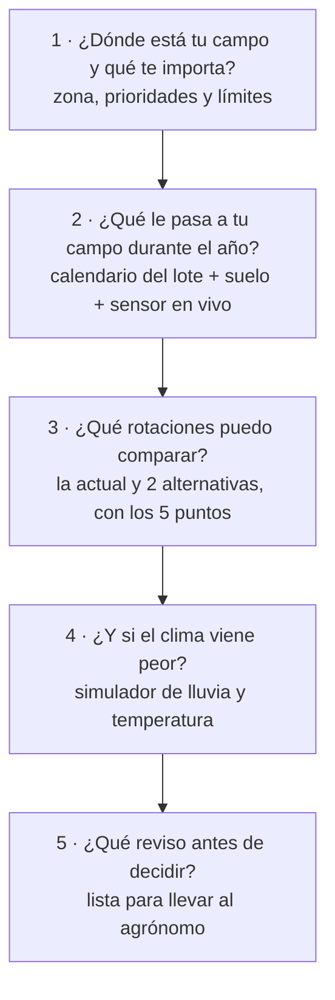
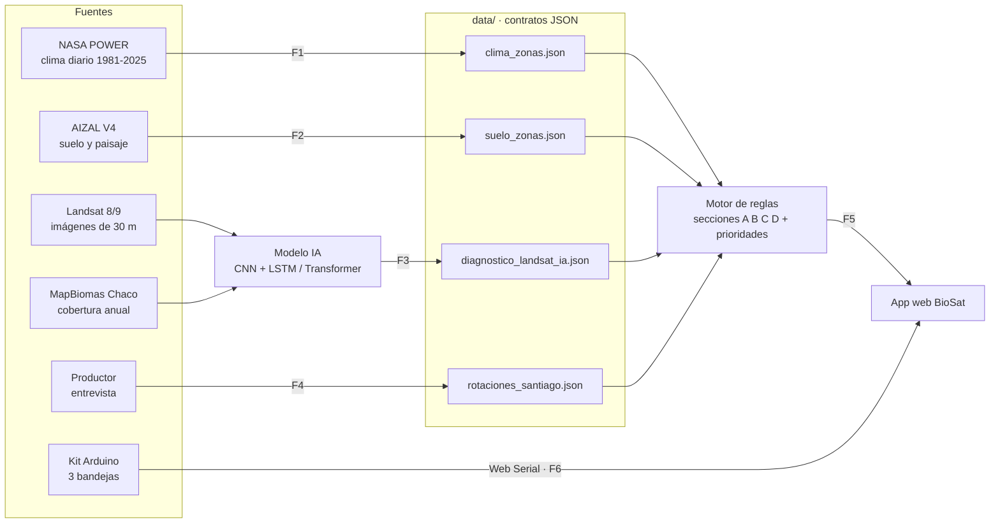
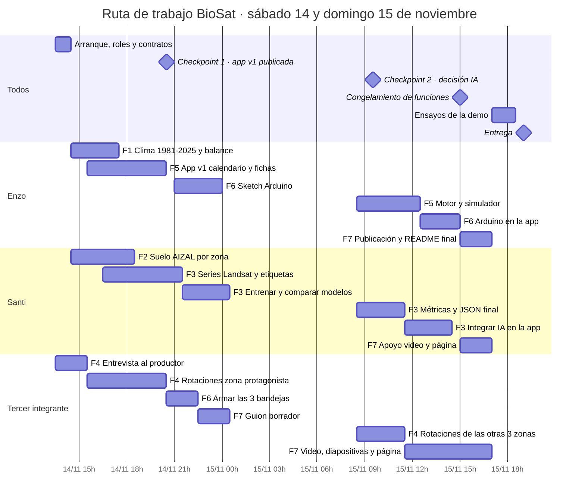

# PLAN de trabajo — BioSat

> **Para qué sirve:** es el **único plan del equipo**. Dice qué vamos a mostrar, quién hace cada cosa, en qué orden y cuándo nos juntamos a integrar.
> **Cómo se usa:** cuando termines una tarea, cambiá `- [ ]` por `- [x]` y subilo. El avance del [README](README.md) se actualiza solo.
> **Reemplaza a:** `docs/plan-de-pasos-y-agentes.md` (decisión D-15 de la [bitácora](docs/reglas-y-bitacora.md)).
> **Última revisión:** sábado 14/11/2026, 13:00.

---

## 1. Qué vamos a mostrar el domingo

Una **app web en español simple** donde un productor de Santiago del Estero recorre 5 pasos:

Y en la mesa del jurado, el **kit Arduino con 3 bandejas de suelo** (pelado, salitroso y con rastrojo), que muestra en vivo lo que el satélite no puede medir de cerca.

**Lo que pide la NASA y dónde lo cumplimos:**

| Pedido del enunciado | Dónde lo resolvemos |
|---|---|
| Comparar al menos 3 rotaciones, incluida la actual | Paso 3 (Frente 4 + Frente 5) |
| Para cada una: por qué, evidencia, beneficios, qué falta saber, riesgos | Fichas de rotación (Frente 4) |
| Mostrar cuándo el suelo queda pelado y cuándo el cultivo sufre | Calendario del lote (Frentes 1, 3 y 5) |
| Que el productor cargue sus prioridades y límites | Paso 1 (Frente 5) |
| Explicar la incertidumbre y que la herramienta **no reemplaza** al productor | En toda la app (Frente 5) |
| Satélite vs. medición en tierra | Kit Arduino (Frente 6) |
| Comparar enfoques de IA y estadística | Modelo IA vs. método simple (Frente 3) |
| Información local de suelo | AIZAL V4 (Frente 2) |

---

## 2. Equipo y roles

Somos **3 personas**, cada una con su agente de IA. Cada rol tiene **sus propias carpetas** para no pisarnos. Los roles son una propuesta: si alguien sabe más de otra cosa, se cambian.

| Rol | Quién | Frentes | Carpetas propias |
|---|---|---|---|
| **Integración, app y Arduino** | Enzo | F1 Clima · F5 App y motor · F6 Arduino | `web/`, `arduino/`, `scripts/descargar_nasa_power.py`, `data/clima_zonas.json` |
| **Suelo, satélite e IA** | Santi | F2 Suelo AIZAL · F3 IA Landsat | `ia_landsat/`, `data/datos_cruzados_aizal/`, `data/suelo_zonas.json`, `data/diagnostico_landsat_ia.json`, `scripts/*.js` |
| **Campo, agronomía y relato** | _Tercer integrante (a confirmar)_ | F4 Rotaciones · F7 Entrega (coordina) | `data/rotaciones_santiago.json`, `entrega/`, textos de `docs/` |

---

## 3. Cómo se conecta todo

Cada frente produce **un archivo JSON** en `data/`. La app solo lee esos archivos, así cada uno puede trabajar sin esperar al otro. El formato de cada archivo está en [`docs/contratos-de-datos.md`](docs/contratos-de-datos.md).

**El motor de reglas** usa las 4 secciones de cultivo de [`docs/documentacion-tecnica-agronomica.md`](docs/documentacion-tecnica-agronomica.md):

- **A:** gramíneas que consumen mucho.
- **B:** leguminosas que fijan nitrógeno.
- **C:** raíces profundas.
- **D:** coberturas.

Con esas secciones, más el clima, el suelo y las prioridades del productor, ordena las 3 rotaciones **y muestra por qué**. No es una caja negra.

---

## 4. Ruta de trabajo

> **A confirmar:** la hora exacta de entrega. Este plan supone **domingo 15/11 a las 19:00** para dejar margen.

| Cuándo | Momento | Qué tiene que estar listo |
|---|---|---|
| Sáb 13:30 | **Arranque** (15 min juntos) | Roles confirmados, contratos acordados, hora de entrega confirmada |
| Sáb 20:30 | **Checkpoint 1** | App v1 publicada con calendario y fichas de la zona protagonista, con datos reales |
| Dom 09:30 | **Checkpoint 2** | Decisión de IA (modelo o método simple), las 4 zonas cargadas |
| Dom 15:00 | **Congelamiento** | No se suman funciones nuevas: solo se arregla y se pule |
| Dom 19:00 | **Entrega** | Proyecto subido a Space Apps, con margen antes del cierre oficial |

---

## 5. Tareas por frente

### F1 · Clima con datos bien medidos (Enzo)

**Objetivo:** que cada número del calendario sea correcto y se pueda defender ante un científico.
**Listo cuando:** existe `data/clima_zonas.json`, el balance de agua da negativo en invierno y el informe compara contra 1991-2020.

- [ ] Ampliar `scripts/descargar_nasa_power.py` a **1981-2025** (hoy usa solo 2020-2025)
- [ ] Calcular lo **normal** con 1991-2020 y lo **reciente** con 2021-2025
- [ ] Corregir la evapotranspiración: `EVPTRNS` viene en MJ/m²/día, no en mm. Calcular la **demanda de agua (ET0, Hargreaves)** y el balance **lluvia − ET0** (hoy da +500 mm al año; lo correcto ronda −900 mm)
- [ ] Agregar rangos entre años (año seco, normal y húmedo) y la probabilidad de helada por mes
- [ ] Agregar las fechas típicas de primera y última helada
- [ ] Mostrar la humedad en raíces (`GWETROOT`) como anomalía contra lo normal, no con umbrales fijos
- [ ] Decidir la Zona 3: hoy mezcla el norte (Campo Gallo) con el sur (Ojo de Agua), pero los datos son solo del norte
- [ ] Generar `data/clima_zonas.json` según el contrato
- [ ] Corregir `docs/analisis-datos-nasa-santiago.md`: comparar contra 1991-2020 y decir "modelo de reanálisis", no "lo detectó el satélite"

### F2 · Suelo y paisaje con AIZAL (Santi)

**Objetivo:** sumar la información local de suelo que pide el enunciado, con datos del Gran Chaco.
**Listo cuando:** cada zona tiene sus valores de suelo con fuente y nivel de confianza.

- [ ] Confirmar acceso al stack AIZAL V4 en Google Earth Engine (o exportar GeoTIFF)
- [ ] Definir el punto o polígono de cada zona y del campo del productor
- [ ] Extraer por zona: pH (B16), arcilla, arena y limo (B12, B17a, B17b), carbono orgánico (B15), nitrógeno (B11), densidad aparente (B18), sequía PDSI (B05), distancia a caminos (B36) y a monte (B31)
- [ ] Agregar el porcentaje de monte nativo por zona (MapBiomas Chaco)
- [ ] Guardar `data/suelo_zonas.json` según el contrato
- [ ] Adaptar `scripts/earth_engine_embeddings.js` a Santiago del Estero (hoy apunta a un punto de California) para buscar zonas parecidas
- [ ] Plan B si no hay acceso a AIZAL: SoilGrids por punto

### F3 · IA con Landsat: suelo pelado y desmonte (Santi)

**Objetivo:** cumplir la idea de la profesora (CNN + RNN + Transformer) de forma que se pueda **medir y defender**.
**Listo cuando:** hay una tabla de métricas que compara los 3 métodos y el JSON tiene solo valores calculados.

- [ ] Bajar series Landsat 8/9 (2016-2025) de muestras en cada zona (Google Earth Engine o Microsoft Planetary Computer, que ya probamos y funciona sin cuenta)
- [ ] Calcular NDVI, NBR y BSI por fecha y armar compuestos mensuales
- [ ] Usar **etiquetas reales** de MapBiomas Chaco (monte, desmonte, agrícola) para entrenar y evaluar
- [ ] Método simple de referencia: umbrales de NDVI y NBR
- [ ] Modelo 1: CNN (mira el parche) + LSTM (mira la secuencia en el tiempo)
- [ ] Modelo 2: CNN + Transformer temporal, para comparar con el modelo 1
- [ ] Evaluar los 3 métodos con zonas que el modelo no vio (exactitud y F1) y guardar la tabla
- [ ] Calcular los **meses de suelo pelado** por zona (van al calendario) y el % de desmonte reciente (Zona 3)
- [ ] Definir el índice de fragilidad como **fórmula visible**, no como salida de una caja negra
- [ ] Guardar `data/diagnostico_landsat_ia.json`, **solo con valores calculados, nunca de ejemplo**

### F4 · Rotaciones y agronomía (Tercer integrante)

**Objetivo:** que las 3 rotaciones de cada zona sean creíbles para un productor santiagueño.
**Listo cuando:** las 12 fichas están en el JSON y las de la zona protagonista fueron revisadas por el productor.

- [ ] Entrevistar al productor con la guía de [`docs/resena-desafio.md`](docs/resena-desafio.md) §10 (pedir permiso para usar su caso)
- [ ] Elegir la **zona protagonista** (la del productor)
- [ ] Escribir las 3 rotaciones de la zona protagonista con los 5 puntos, marcando la sección A/B/C/D de cada cultivo
- [ ] Revisarlas con el productor y, si se puede, con un agrónomo o el INTA
- [ ] Escribir las rotaciones de las otras 3 zonas (versión corta, a partir de [`docs/zonas-santiago-y-kit-arduino.md`](docs/zonas-santiago-y-kit-arduino.md))
- [ ] Citar la fuente de cada afirmación agronómica (INTA, trabajos publicados)
- [ ] Guardar `data/rotaciones_santiago.json` según el contrato
- [ ] Corregir los textos del kit: el sensor de agua no distingue salitre de humedad sin calibrar, y el LDR mide luz, no NDVI

### F5 · App web y motor de reglas (Enzo)

**Objetivo:** que un productor recorra los 5 pasos sin ayuda y entienda de dónde sale cada dato.
**Listo cuando:** hay un link público que funciona en celular y una copia que funciona sin internet.

- [ ] Crear `web/` con HTML y JavaScript sin instalación, que lea los JSON de `data/`
- [ ] Paso 1: zona, prioridades (ahorrar agua, frenar salitre, recuperar suelo, forraje, ingreso) y límites (riego, maquinaria, ganado)
- [ ] Paso 2: **calendario del lote** con 12 meses (calor, helada, falta de agua y suelo pelado de cada rotación)
- [ ] Paso 3: comparador de las 3 rotaciones con los 5 puntos y "qué falta saber"
- [ ] Motor de reglas transparente (secciones A/B/C/D + prioridades) que ordena las rotaciones y **explica por qué**
- [ ] Paso 4: simulador de lluvia (−30 % a +20 %) y temperatura (+0 a +2,5 °C)
- [ ] Paso 5: lista para llevar al agrónomo (imprimible)
- [ ] Mostrar siempre "apoya, no reemplaza" y la fuente de cada dato
- [ ] Publicar en GitHub Pages
- [ ] Probar en celular y sin internet

### F6 · Kit Arduino "Espacio vs. Tierra" (Enzo, con armado del tercer integrante)

**Objetivo:** mostrar en vivo que el suelo pelado se calienta y se seca mucho más que el cubierto.
**Listo cuando:** la demo funciona con el Arduino conectado y también sin él.

- [ ] Sketch `arduino/biosat_estacion_campo/biosat_estacion_campo.ino`: sensor de agua (A0), LM35 (A1), LDR (A2), DHT11, LEDs y LCD, con una línea JSON cada 2 segundos
- [ ] Armar las 3 bandejas: pelada y seca, salitrosa, con rastrojo
- [ ] Calibrar los umbrales con las bandejas reales
- [ ] Leer el Arduino desde la app con Web Serial (Chrome o Edge), sin programa intermedio
- [ ] Grabar lecturas reales de las 3 bandejas como respaldo en `data/arduino_bandejas_demo.json`

### F7 · Entrega y presentación (todos; coordina el tercer integrante)

**Objetivo:** que el jurado entienda la historia en 2 minutos y que la entrega llegue a tiempo.
**Listo cuando:** el proyecto está subido a Space Apps y la demo se ensayó 2 veces.

- [ ] Confirmar la hora de entrega y el formato en la guía del participante (desde el celular, porque en la PC falla el certificado del sitio)
- [ ] Guion de 2-3 minutos: el productor → el calendario → las rotaciones → las bandejas
- [ ] Video o diapositivas según el formato que pidan
- [ ] Página del proyecto en Space Apps: resumen, datos de la NASA usados, link al repo y a la app
- [ ] Declarar el uso de herramientas de IA si la guía lo pide
- [ ] Revisar las reglas de uso de marcas (no usar logos de la NASA si no está permitido)
- [ ] Revisar el README final
- [ ] Hacer 2 ensayos completos de la demo
- [ ] Subir la entrega con margen

---

## 6. Archivos que compartimos (contratos)

| Archivo | Lo produce | Lo usa |
|---|---|---|
| `data/clima_zonas.json` | F1 (Enzo) | App, IA, motor |
| `data/suelo_zonas.json` | F2 (Santi) | Motor, app |
| `data/diagnostico_landsat_ia.json` | F3 (Santi) | Calendario, motor |
| `data/rotaciones_santiago.json` | F4 (tercer integrante) | Comparador, motor |
| Línea JSON del Arduino + `data/arduino_bandejas_demo.json` | F6 (Enzo) | App |

El detalle de cada campo está en [`docs/contratos-de-datos.md`](docs/contratos-de-datos.md). **Si un dato falta, va `null` y la app muestra "sin dato".** Nunca se completa con un número inventado.

---

## 7. Reglas para no pisarnos

1. **Cada uno en sus carpetas** (tabla de la sección 2). En los archivos compartidos:
   - `PLAN.md`: solo se tildan casillas.
   - Bitácora: solo se agregan líneas al final.
   - README: solo se tocan las partes manuales.
2. **`git pull --rebase` antes de cada `git push`.** Commits chicos y seguidos.
3. **Commits sin la línea `Co-Authored-By`** (convención del equipo).
4. **Los agentes de IA** leen `README.md`, `PLAN.md` y `docs/contratos-de-datos.md` antes de tocar código, y trabajan solo en las carpetas de su rol.
5. Cada decisión importante va a la [bitácora](docs/reglas-y-bitacora.md). Cada término nuevo va al [glosario](docs/glosario.md).

---

## 8. Puntos de decisión y plan B

| Si a esta hora… | …no está esto | Plan B |
|---|---|---|
| Sáb 15:30 | La entrevista al productor | Zona 2 (secano) como protagonista; validar las fichas por mensaje o teléfono |
| Sáb 18:30 | Acceso a AIZAL | SoilGrids por punto |
| Sáb 21:30 | Series Landsat | Seguir con las escenas que haya y el método de umbrales |
| Dom 09:30 | Un modelo de IA mejor que el método simple | La app usa el método simple; el modelo se muestra como experimento con sus métricas (comparar enfoques también es lo que pide el enunciado) |
| Dom 12:00 | Arduino estable | La app usa las lecturas grabadas de las bandejas |
| Dom 15:00 | Simulador | Se presenta sin simulador |

---

## 9. Qué cambió respecto del plan anterior

- **Somos 3 personas:** pasamos de 2 agentes a 7 frentes en paralelo, sin recortar el alcance.
- **Clima bien medido:** usamos 45 años (1981-2025) en lugar de 6 y corregimos el balance de agua. Medido así, el calor extremo sí se duplicó: en la Zona 3 hubo 17 días al año de más de 40 °C en 1991-2020 y 38 en 2021-2025.
- **IA medible:** mantenemos CNN + RNN + Transformer, pero entrenados con etiquetas reales (MapBiomas Chaco) y comparados contra un método simple, como pide el enunciado.
- **Suelo local:** se suma AIZAL V4, el aporte de Santi, para cubrir la "información local de suelo".
- **Motor transparente:** usa las secciones A/B/C/D de Santi.
- **El productor vuelve al centro:** su zona es la protagonista y él revisa las fichas.
- **Contratos de datos para los 4 archivos compartidos:** antes solo había uno.
- **Prototipo en Santiago del Estero:** prevalece sobre la nota de [`docs/documentacion-tecnica-agronomica.md`](docs/documentacion-tecnica-agronomica.md) que proponía hacerlo en EE. UU. (D-09).

---

## 10. Preguntas abiertas

- [ ] ¿A qué hora exacta cierra la entrega y en qué formato?
- [ ] ¿Quién es el tercer integrante? ¿Están bien los roles?
- [ ] ¿Santi tiene acceso al stack AIZAL V4 en Google Earth Engine?
- [ ] ¿Dónde está el campo del productor y qué siembra hoy?
- [ ] `data/datos_cruzados_aizal/CATALOGO_MAESTRO_VARIABLES.md` cita `docs/CONTEXTONASA.md`, que no está en el repo: ¿falta subirlo?
