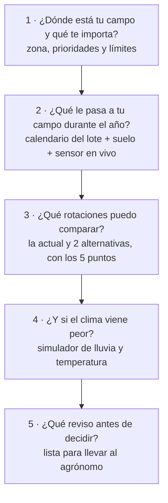
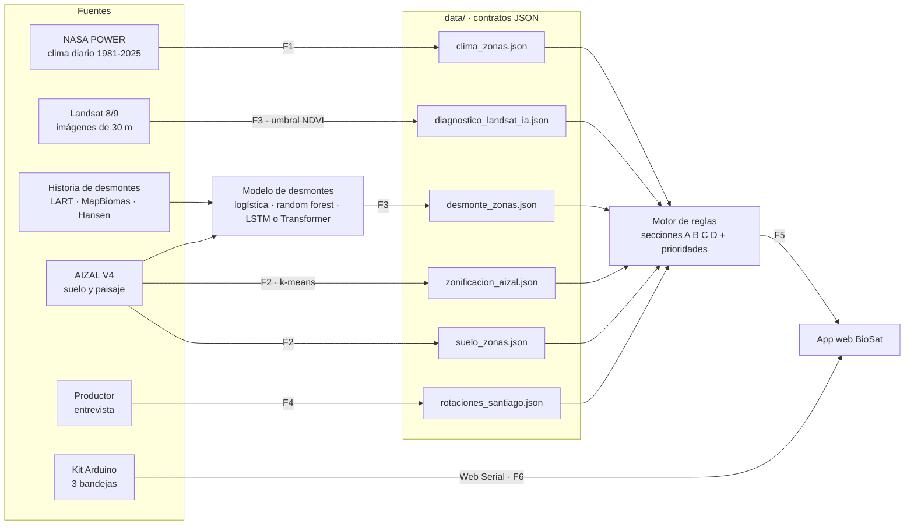
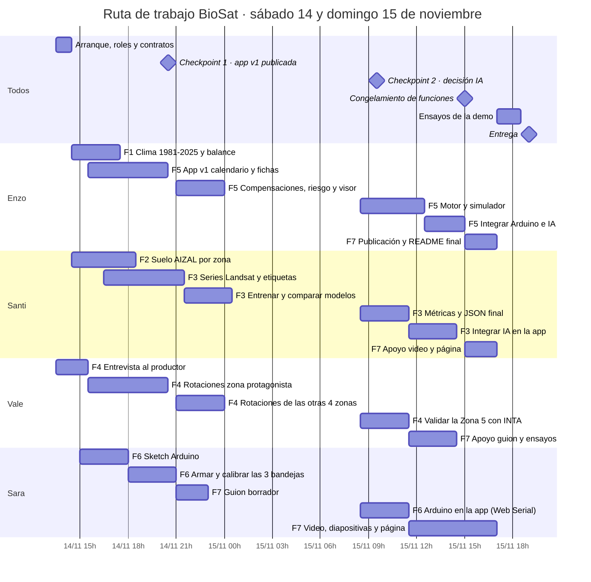

# PLAN de trabajo — BioSat

> **Para qué sirve:** es el **único plan del equipo**. Dice qué vamos a mostrar, quién hace cada cosa, en qué orden y cuándo nos juntamos a integrar.
> **Cómo se usa:** este es el plan general. Las tareas de cada uno, con sus casillas, están en su plan personal en [`planes/`](planes/README.md). Cuando termines una, tildala en tu plan; el avance del [README](README.md) se actualiza solo al integrar a `main`.
> **Reemplaza a:** `docs/plan-de-pasos-y-agentes.md` (decisión D-15 de la [bitácora](docs/reglas-y-bitacora.md)).
> **Última revisión:** sábado 14/11/2026, noche (kit para el jurado y guía del campo, D-27; ver el [estado del proyecto](docs/estado-del-proyecto.md)).

---

## 1. Qué vamos a mostrar el domingo

Una **app web en español simple** donde un productor de Santiago del Estero recorre 5 pasos:

Y en la mesa del jurado, el **kit Arduino con 3 bandejas de suelo** (pelado, salitroso y con rastrojo), que muestra en vivo lo que el satélite no puede medir de cerca.

**Lo que pide la NASA y dónde lo cumplimos:**

| Pedido del enunciado | Dónde lo resolvemos |
|---|---|
| Comparar al menos 3 rotaciones, incluida la actual | Paso 3 (Frente 4 + Frente 5) |
| Para cada una: por qué, evidencia, beneficios, qué falta saber, riesgos | Fichas de rotación (Frente 4) |
| Mostrar cuándo el suelo queda pelado y cuándo el cultivo sufre | Calendario del lote (Frentes 1, 3 y 5) |
| Que el productor cargue sus prioridades y límites | Paso 1 (Frente 5) |
| Explicar la incertidumbre y que la herramienta **no reemplaza** al productor | En toda la app (Frente 5) |
| Satélite vs. medición en tierra | Kit Arduino (Frente 6) |
| Comparar enfoques de IA y estadística | Modelo de desmontes: regresión logística contra random forest contra LSTM o Transformer (Frente 3) |
| Información local de suelo | AIZAL V4 (Frente 2) |

**Lo que pide el video del desafío** ([transcripción](docs/transcripcion-video-desafio.md)), en cuatro verbos:

| Verbo | Cómo lo mostramos |
|---|---|
| Comparar rotaciones | Paso 3: las 3 rotaciones ordenadas según las prioridades |
| Revelar compensaciones | Bloque "qué ganás y qué te cuesta" en cada rotación + gráfico de agua contra protección del suelo |
| Comprender el riesgo | Riesgo como frecuencia: "en 1 de cada 5 años…", calculado año por año con NASA POWER |
| Hacer visible la incertidumbre | Etiqueta de confianza (alta, media o baja) en cada dato, con el porqué |

---

## 2. Equipo y roles

Somos **4 personas**: Enzo, Santi, Vale y Sara, cada una con su agente de IA. Cada rol tiene **sus propias carpetas** para no pisarnos. Los roles son una propuesta: si alguien sabe más de otra cosa, se cambian.

| # | Quién | Rol | Frentes | Rama | Plan y checklist |
|---|---|---|---|---|---|
| 1 | **Enzo** | Integración y app | F1 Clima · F5 App y motor | `enzo-app` | [planes/1-enzo.md](planes/1-enzo.md) |
| 2 | **Santi** | Suelo, satélite e IA | F2 Suelo y zonificación AIZAL · F3 Modelo de desmontes | `santi-datos-ia` | [planes/2-santi.md](planes/2-santi.md) |
| 3 | **Vale** | Campo y agronomía | F4 Rotaciones (incluye validar la Zona 5) | `vale-rotaciones` | [planes/3-vale.md](planes/3-vale.md) |
| 4 | **Sara** | Kit Arduino y relato | F6 Arduino · F7 Entrega (coordina) | `sara-arduino-entrega` | [planes/4-sara.md](planes/4-sara.md) |

Cada uno trabaja en **su rama** y en **sus archivos**: la lista completa de quién es dueño de qué está en [`planes/README.md`](planes/README.md).

Al sumarse Sara (D-22), Enzo deja el Arduino para concentrarse en la app, y Vale deja la coordinación de la entrega para concentrarse en las rotaciones de las 5 zonas.

---

## 3. Cómo se conecta todo

Cada frente produce **un archivo JSON** en `data/`. La app solo lee esos archivos, así cada uno puede trabajar sin esperar al otro. El formato de cada archivo está en [`docs/contratos-de-datos.md`](docs/contratos-de-datos.md).

**El motor de reglas** usa las 4 secciones de cultivo de [`docs/documentacion-tecnica-agronomica.md`](docs/documentacion-tecnica-agronomica.md):

- **A:** gramíneas que consumen mucho.
- **B:** leguminosas que fijan nitrógeno.
- **C:** raíces profundas.
- **D:** coberturas.

Con esas secciones, más el clima, el suelo y las prioridades del productor, ordena las 3 rotaciones **y muestra por qué**. No es una caja negra.

---

## 4. Ruta de trabajo

> **A confirmar:** la hora exacta de entrega. Este plan supone **domingo 15/11 a las 19:00** para dejar margen.

| Cuándo | Momento | Qué tiene que estar listo |
|---|---|---|
| Sáb 13:30 | **Arranque** (15 min juntos) | Roles confirmados, contratos acordados, hora de entrega confirmada |
| Sáb 16:30 | **Hito 0** | Cada uno en su rama, con su plan revisado; hora y formato de la entrega confirmados |
| Sáb 20:30 | **Checkpoint 1** | App v1 publicada con calendario y fichas de la zona protagonista, con datos reales |
| Dom 09:30 | **Checkpoint 2** | Decisión de IA (modelo o método simple), las 5 zonas cargadas |
| Dom 15:00 | **Congelamiento** | No se suman funciones nuevas: solo se arregla y se pule |
| Dom 19:00 | **Entrega** | Proyecto subido a Space Apps, con margen antes del cierre oficial |

---

## 5. Tareas por frente

Las tareas detalladas, con sus casillas, están en el **plan de cada persona**. Así cada uno tilda en su propio archivo, en su rama, sin pisar a nadie. Este resumen sirve para ver qué busca cada frente.

| Frente | Quién | Objetivo | Listo cuando |
|---|---|---|---|
| F1 · Clima con datos bien medidos | [Enzo](planes/1-enzo.md) | Que cada número del calendario sea correcto y defendible | `data/clima_zonas.json` real para las 5 zonas, con la normal 1991-2020 y el balance lluvia − ET0 |
| F2 · Suelo y zonificación AIZAL | [Santi](planes/2-santi.md) | Sumar el suelo local y zonificar la provincia con clima y suelo (propuesta de la profesora) | Suelo por zona con fuente y confianza, y zonificación AIZAL comparada con las 5 zonas |
| F3 · IA: modelo predictivo de desmontes | [Santi](planes/2-santi.md) | Predecir el desmonte por zona de forma medible (propuesta de la profesora) | Métricas de los 3 modelos con validación temporal y riesgo por zona en `desmonte_zonas.json` |
| F4 · Rotaciones y agronomía | [Vale](planes/3-vale.md) | Rotaciones creíbles para un productor santiagueño | 15 rotaciones en el JSON, la zona protagonista validada y fuentes citadas |
| F5 · App web y motor de reglas | [Enzo](planes/1-enzo.md) | Que un productor recorra los 5 pasos sin ayuda | Link público que anda en celular y copia sin internet |
| F6 · Kit Arduino | [Sara](planes/4-sara.md) | Mostrar en vivo suelo pelado contra cubierto | La demo anda con y sin Arduino |
| F7 · Entrega y presentación | [Sara](planes/4-sara.md) (con todos) | Historia clara en 2 minutos y entrega a tiempo | Entrega subida y 2 ensayos hechos |

El avance de cada uno se ve en el [README](README.md), contado desde los planes.

---

## 6. Archivos que compartimos (contratos)

| Archivo | Lo produce | Lo usa |
|---|---|---|
| `data/clima_zonas.json` | F1 (Enzo) | App, IA, motor |
| `data/suelo_zonas.json` | F2 (Santi) | Motor, app |
| `data/diagnostico_landsat_ia.json` | F3 (Santi) | Calendario, motor |
| `data/zonificacion_aizal.json` | F2 (Santi) | Validación de las zonas |
| `data/desmonte_zonas.json` | F3 (Santi) | App (presión de desmonte), motor |
| `data/rotaciones_santiago.json` | F4 (Vale) | Comparador, motor |
| Línea JSON del Arduino + `data/arduino_bandejas_demo.json` | F6 (Sara) | App |

El detalle de cada campo está en [`docs/contratos-de-datos.md`](docs/contratos-de-datos.md). **Si un dato falta, va `null` y la app muestra "sin dato".** Nunca se completa con un número inventado.

---

## 7. Reglas para no pisarnos

El detalle está en [`planes/README.md`](planes/README.md). En corto:

1. **Cada uno en su rama** (`enzo-app`, `santi-datos-ia`, `vale-rotaciones`, `sara-arduino-entrega`). Nadie sube directo a `main`.
2. **Cada uno en sus archivos.** Los compartidos (`PLAN.md`, `README.md`, bitácora, contratos) los toca solo Enzo, en `main`.
3. **Integración en cada hito** con un *Pull Request* a `main`: primero los datos (Santi, Vale, Sara) y al final la app (Enzo).
4. **Traer lo de los demás:** `git fetch origin && git merge origin/main` en tu rama.
5. **Decisiones** en la sección "Mis decisiones" de tu plan; Enzo las pasa a la [bitácora](docs/reglas-y-bitacora.md).
6. **Commits sin la línea `Co-Authored-By`** (convención del equipo).
7. **Agentes de IA:** leen `planes/README.md`, el plan de su dueño y los contratos antes de tocar nada.

---

## 8. Puntos de decisión y plan B

| Si a esta hora… | …no está esto | Plan B |
|---|---|---|
| Sáb 15:30 | La entrevista al productor | Zona 2 (secano) como protagonista; validar las fichas por mensaje o teléfono |
| Sáb 18:30 | Acceso a AIZAL | SoilGrids por punto |
| Sáb 21:30 | La base de desmontes del LART (desde 1976) | MapBiomas Chaco (1985-2023) o Hansen (2001-2023) |
| Dom 09:30 | El modelo temporal de desmontes (LSTM o Transformer) | Se presentan la regresión logística y el random forest con sus métricas (comparar enfoques también es lo que pide el enunciado) |
| Dom 12:00 | Arduino estable | La app usa las lecturas grabadas de las bandejas |
| Dom 15:00 | Simulador | Se presenta sin simulador |

---

## 9. Qué cambió respecto del plan anterior

- **Somos 4 personas (Enzo, Santi, Vale y Sara):** pasamos de 2 agentes a 7 frentes en paralelo, sin recortar el alcance.
- **Clima bien medido:** usamos 45 años (1981-2025) en lugar de 6 y corregimos el balance de agua. Medido así, el calor extremo sí se duplicó: en la Zona 3 hubo 17 días al año de más de 40 °C en 1991-2020 y 38 en 2021-2025.
- **IA medible:** mantenemos CNN + RNN + Transformer, pero entrenados con etiquetas reales (MapBiomas Chaco) y comparados contra un método simple, como pide el enunciado.
- **Suelo local:** se suma AIZAL V4, el aporte de Santi, para cubrir la "información local de suelo".
- **Motor transparente:** usa las secciones A/B/C/D de Santi.
- **El productor vuelve al centro:** su zona es la protagonista y él revisa las fichas.
- **Contratos de datos para los 4 archivos compartidos:** antes solo había uno.
- **Video del desafío (D-17):** se suman los cuatro verbos (comparar, compensaciones, riesgo, incertidumbre) y el zoom de escalas para el pitch.
- **Zona 5 (D-18, D-20, D-21):** el sur serrano tiene otro clima. Se separa de la Zona 3 y queda confirmada; ya tiene clima real y faltan validar sus rotaciones.
- **Propuesta de la profesora (D-25):** zonificación de la provincia con AIZAL (k-means sobre clima y suelo) y modelo predictivo de desmontes por zona. La CNN sobre parches de Landsat queda fuera.
- **Visor GIS (D-19):** scripts de Google Earth Engine para el visor y la exportación por zona; el mockup ya muestra imágenes Landsat reales.
- **Prototipo en Santiago del Estero:** prevalece sobre la nota de [`docs/documentacion-tecnica-agronomica.md`](docs/documentacion-tecnica-agronomica.md) que proponía hacerlo en EE. UU. (D-09).

---

## 10. Preguntas abiertas

- [ ] ¿A qué hora exacta cierra la entrega y en qué formato? (El video del desafío confirma las fechas 14 y 15/11, pero no dice el formato.)
- [x] Integrantes: Enzo, Santi, Vale y Sara (D-22)
- [x] ¿Están bien los roles de la sección 2? (se trabaja con ellos desde D-23)
- [x] ¿Santi tiene acceso al stack AIZAL V4 en Google Earth Engine? (confirmado en su plan)
- [ ] ¿Conseguimos la base de desmontes del LART desde 1976? (monitoreodesmonte.com.ar está caído; escribirles)
- [x] ¿Dónde está el campo del productor y qué siembra hoy? (Bella Criolla, Río Utis: ganadería con pasturas y monte; ver la [entrevista](docs/entrevista-productor-bella-criolla.md))
- [ ] `data/datos_cruzados_aizal/CATALOGO_MAESTRO_VARIABLES.md` cita `docs/CONTEXTONASA.md`, que no está en el repo: ¿falta subirlo?
