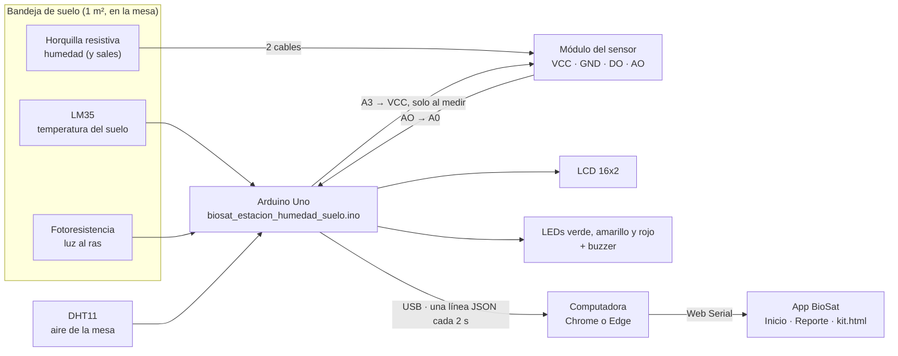
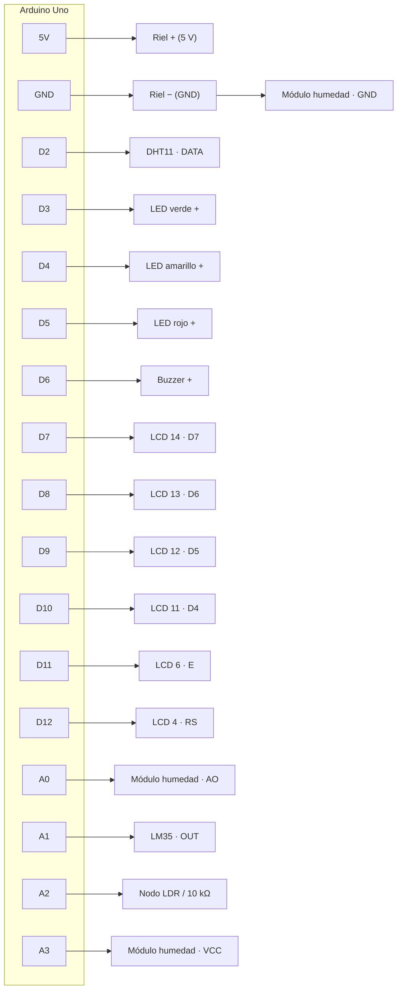
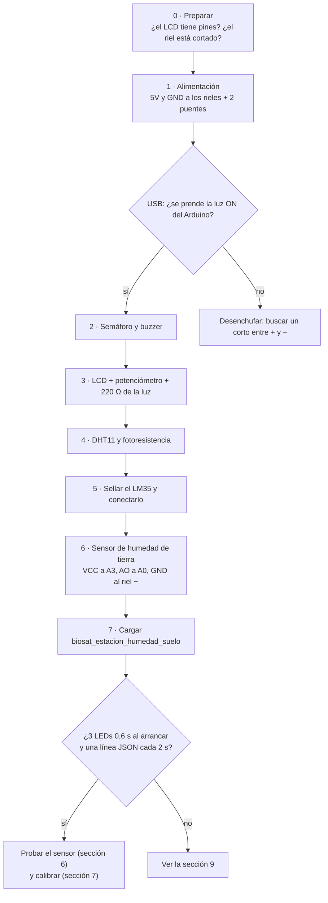
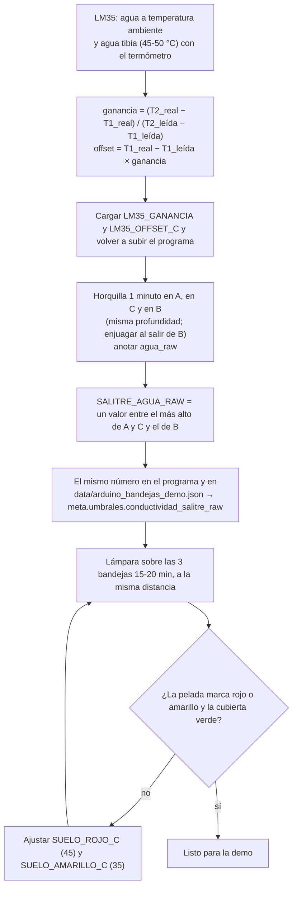

# Guía de armado en protoboard · Variante con sensor de humedad de tierra resistivo

> **Para quien la ejecute (persona o agente):** esta es la guía del kit **tal como se arma desde el 15/11**, con el **sensor de humedad de tierra resistivo** (prestado) en lugar del sensor de nivel de agua del kit. Alcanza sola para armar, cargar, probar y calibrar. El programa es [`biosat_estacion_humedad_suelo/biosat_estacion_humedad_suelo.ino`](biosat_estacion_humedad_suelo/biosat_estacion_humedad_suelo.ino). La guía del sensor de nivel de agua sigue en [`GUIA-PROTOBOARD.md`](GUIA-PROTOBOARD.md), por si se vuelve a ese sensor.
>
> **Los pines son los mismos que en [`esquema/pines.json`](esquema/pines.json)**, la fuente única. Ahí el sensor figura como "sonda" (sensor de nivel de agua), y sus 3 cables se corresponden así: **+ → VCC**, **S → AO** y **− → GND**. Una prueba (`tests/arduino-pines.test.js`) revisa que los dos programas usen los mismos pines y que este dé vuelta la lectura.

## 0. Dónde quedó el armado (15/11, tarde)

Lo que ya se probó en la placa, según la [bitácora](../docs/reglas-y-bitacora.md):

- [x] El programa de esta variante está compilado y subido a la placa (con `arduino-cli`, puerto COM6).
- [x] La línea JSON llega cada 2 segundos.
- [x] El LM35 estaba al revés (marcaba de 55 a 99 °C). Se dio vuelta y ahora da de 30 a 37 °C.
- [ ] **El DHT11 da `null`.** Ver la sección 9.1.
- [ ] **El LCD no prende.** Ver la sección 9.2.
- [ ] **Probar el sensor de humedad** al aire, en agua y en agua salada (sección 6).
- [ ] Calibrar el LM35 con 2 temperaturas y recalibrar `SALITRE_AGUA_RAW` con las bandejas (sección 7).
- [ ] Grabar lecturas reales de las 3 bandejas en `data/arduino_bandejas_demo.json` (sección 8).

## 1. Qué cambia respecto de la guía original

| | Guía original | Esta variante |
|---|---|---|
| Sensor de humedad | Sensor de nivel de agua del kit (pieza 31): una placa de pistas con 3 pines (+, − y S) | **Sensor de humedad de tierra resistivo**: una **horquilla** de 2 patas metálicas y un **módulo** con potenciómetro y 4 pines (**VCC, GND, DO y AO**) |
| Programa | `biosat_estacion_campo/` | **`biosat_estacion_humedad_suelo/`** |
| Cómo responde | La lectura sube con el agua | El módulo da **1023 con la horquilla seca** y baja al mojarse. **El programa la da vuelta** (`1023 − lectura`) |
| `agua_raw` en la app | Más alto = más húmedo o más conductivo | **Igual.** La app, el semáforo, la pantalla del kit y el aviso de salitre no cambian |
| Umbral de salitre | 700 como punto de partida | 700 **solo como punto de partida**: el número de este sensor es otro y **hay que recalibrarlo** |
| Todo lo demás | LM35, DHT11, fotoresistencia, LCD, LEDs y buzzer | **Igual, con los mismos pines** |



**Qué mide este sensor y qué no:** la horquilla mide qué tan fácil pasa la corriente entre sus dos patas. Sube con el agua **y** con las sales. No da un % de humedad: sirve para **comparar bandejas**. Una horquilla de este tipo se corroe si queda alimentada todo el tiempo; por eso el programa la prende solo un instante en cada lectura.

## 2. Qué piezas se usan

| # | Pieza | ¿Se usa? | Para qué |
|---|---|---|---|
| 1 | Placa UNO | **Sí** | El cerebro. Se alimenta y manda datos por el USB |
| 18 | Cable USB A/B | **Sí** | Alimentación y datos |
| 13 | Protoboard de 830 puntos | **Sí** | Para armar sin soldar (ver 4) |
| 7, 17 | Cables macho-macho y macho-hembra | **Sí** | Macho-hembra para los módulos (DHT11 y sensor de humedad) |
| — | **Sensor de humedad de tierra resistivo** (prestado, fuera del kit) | **Sí** | Horquilla + módulo + los 2 cables hembra-hembra que los unen |
| 8 | LM35 | **Sí** | **Temperatura del suelo**: el sensor que más importa |
| 12 | Fotoresistencias | **Sí** (1) | Luz al ras del suelo |
| 34 | Módulo DHT11 | **Sí** | Temperatura y humedad del aire |
| 32 | Display LCD fondo azul (16x2 en paralelo) | **Sí** | Muestra las lecturas en la mesa |
| 35 | Potenciómetro B10k | **Sí** | Contraste del LCD |
| 33 | LEDs | **Sí** (verde, amarillo y rojo) | Semáforo del suelo |
| 3 | Buzzer | **Sí** (1) | Suena al pasar a rojo |
| 25 | Resistencias 220 Ω y 10 kΩ | **Sí** | 4 de 220 Ω (3 LEDs y la luz del LCD) y 1 de 10 kΩ (fotoresistencia) |
| 36 | Tira de pines 1x40 | **Solo si el LCD no trae pines** | Hay que soldar 16 pines al LCD |
| 31 | Sensor de nivel de agua | **No** | Lo reemplaza el sensor de humedad de tierra |

**Fuera del kit:** 3 recipientes de unos 20 × 30 cm, tierra, sal fina, rastrojo o paja seca, una lámpara incandescente o un velador, termocontraíble o cinta aisladora y silicona (para sellar el LM35), un termómetro de cocina o médico, **2 vasos** (uno con agua de la canilla y otro con agua bien salada) y **papel de cocina** (para secar la horquilla entre bandejas).

## 3. Mapa de conexiones

| Pin del Arduino | Va a | Nota |
|---|---|---|
| **5V** | riel + de la protoboard | Alimenta todo, **menos el sensor de humedad** |
| **GND** | riel − de la protoboard | Tierra común |
| **D2** | DHT11 · DATA (S) | |
| **D3, D4, D5** | LED verde, amarillo, rojo · pata larga (+) | La pata corta (−) va por una resistencia de **220 Ω** al riel − |
| **D6** | Buzzer (+) | El (−) va al riel − |
| **D7, D8, D9, D10** | LCD · pines 14 (D7), 13 (D6), 12 (D5), 11 (D4) | |
| **D11** | LCD · pin 6 (E) | |
| **D12** | LCD · pin 4 (RS) | |
| **A0** | Módulo del sensor de humedad · **AO** | La lectura analógica |
| **A1** | LM35 · OUT (pata del medio) | El pin **AREF queda sin conectar** |
| **A2** | Nodo entre la fotoresistencia y la de 10 kΩ | |
| **A3** | Módulo del sensor de humedad · **VCC** | **No va a 5V.** El programa le da corriente solo al medir, así la horquilla no se corroe |
| — | Módulo del sensor de humedad · **GND** | Al riel − |
| — | Módulo del sensor de humedad · **DO** | **Sin conectar** |



## 4. Dónde va cada cosa en la protoboard

### 4.1 Cómo está conectada por dentro

- **4 rieles largos**, 2 arriba y 2 abajo, marcados **+** (rojo) y **−** (azul), conectados de punta a punta. **Ojo:** en algunas protoboards el riel está cortado a la mitad. Comprobalo con un cable o un tester.
- **63 columnas.** En cada una, los agujeros **a a e** están conectados entre sí, y los **f a j** también, pero aparte.
- **La canaleta central** separa las dos mitades: lo de arriba y lo de abajo **no** se tocan.

```text
   riel +  ++++++++++++++++++++++++++++++++++++++   (5 V)
   riel −  --------------------------------------   (GND)
     a-e   o o o o o o o o o o o o o o o o o o ...   cada columna (a-e) es un solo cable
           ======= canaleta (no conecta) ========
     f-j   o o o o o o o o o o o o o o o o o o ...   cada columna (f-j) es otro cable
   riel +  ++++++++++++++++++++++++++++++++++++++   (5 V)
   riel −  --------------------------------------   (GND)
           1 2 3 4 5 ...                    ... 63
```

### 4.2 Plan de ubicación

Las columnas son de ejemplo. Si algo no encaja, corré la zona unas columnas: lo que importa son las conexiones de la sección 3.

| Zona | Columnas | Mitad | Qué va |
|---|---|---|---|
| Alimentación | rieles | arriba y abajo | 5V al riel + de arriba y GND al riel − de arriba. **2 puentes** unen los rieles de arriba con los de abajo (+ con + y − con −) |
| LCD | 3 a 18 | abajo, fila **j** | Los 16 pines del LCD, del pin 1 (columna 3) al 16 (columna 18) |
| Luz del LCD | 17 | abajo | Resistencia de 220 Ω entre la columna 17 (pin 15, A) y el riel + |
| Contraste | 22 a 26 | abajo | Potenciómetro: un extremo al riel +, el otro al riel − y el cursor a la columna 5 (pin 3, V0) |
| Sonda LM35 | 29 a 31 | abajo | Los 3 cables largos del LM35 sellado: +Vs al riel +, OUT a A1 y GND al riel − |
| Semáforo | 34 a 45 | arriba | 3 LEDs, cada uno en 2 columnas (pata larga a la izquierda). De la pata corta, 220 Ω al riel − |
| Buzzer | 48 a 51 | arriba | (+) a D6 y (−) al riel − |
| Luz (LDR) | 54 a 56 | arriba | LDR entre la 54 y la 56; la 54 al riel +; 10 kΩ de la 56 al riel −; la 56 a A2 |
| DHT11 | 59 a 61 | arriba | + al riel +, − al riel − y S (DATA) a D2 |
| **Sensor de humedad** | **fuera de la protoboard** | — | **Módulo** con macho-hembra: VCC a **A3**, AO a **A0** y GND al riel −. **Horquilla** al módulo con sus 2 cables hembra-hembra |

**Dónde dejar el módulo:** fuera de la bandeja y seco, al lado de la protoboard. A la tierra va **solo la horquilla**.

## 5. Armado paso a paso

> **Regla de oro: todo se conecta con el USB desenchufado.** Se enchufa recién en la verificación de cada fase.



### Fase 0 · Preparar
- [ ] Mirar si el LCD trae los 16 pines **soldados**. Apoyados sin soldar no hacen contacto.
- [ ] Con un cable, comprobar que cada riel conecta de punta a punta. Si está cortado a la mitad, poner un puente en el corte.
- [ ] Separar las resistencias: **220 Ω** (rojo-rojo-marrón) × 4 y **10 kΩ** (marrón-negro-naranja) × 1.

### Fase 1 · Alimentación
- [ ] Cable rojo del **5V** al **riel +** de arriba; cable negro del **GND** al **riel −** de arriba.
- [ ] Puentes: riel + de arriba con riel + de abajo, y riel − de arriba con riel − de abajo. **Sin estos puentes, el LCD y el LM35 (que van abajo) quedan sin corriente.**
- [ ] **Verificar:** al enchufar el USB se prende la luz ON del Arduino y no se calienta nada. Desenchufar.

### Fase 2 · Semáforo y buzzer
- [ ] Cada LED con la **pata larga (+)** en una columna y la **corta (−)** en la siguiente.
- [ ] De la columna de la pata corta, una **resistencia de 220 Ω** al **riel −**.
- [ ] Cables de la pata larga: verde a **D3**, amarillo a **D4** y rojo a **D5**.
- [ ] Buzzer: (+), la pata marcada o la más larga, a **D6**, y (−) al **riel −**.

### Fase 3 · LCD
- [ ] LCD en la fila **j**, columnas 3 a 18 (pin 1 en la columna 3).
- [ ] **Alimentación:** pin 1 (VSS) al riel −, pin 2 (VDD) al riel +, pin 5 (RW) al riel − y pin 16 (K) al riel −.
- [ ] **Pin 15 (A, luz de fondo)** al riel + **a través de una resistencia de 220 Ω**.
- [ ] **Potenciómetro:** un extremo al riel +, el otro al riel − y el **cursor (pata del medio) al pin 3 (V0)**.
- [ ] **Datos:** pin 4 (RS) a **D12**, pin 6 (E) a **D11**, pin 11 (D4) a **D10**, pin 12 (D5) a **D9**, pin 13 (D6) a **D8** y pin 14 (D7) a **D7**.
- Los pines 7 a 10 del LCD **quedan sin conectar** (modo de 4 bits).
- [ ] **Verificar:** al enchufar el USB, la luz de fondo se prende aunque el programa no esté cargado. Si no se prende, ir a la sección 9.2 antes de seguir.

### Fase 4 · DHT11 y fotoresistencia
- [ ] **DHT11:** seguir lo impreso en el módulo, porque el orden cambia según la marca. **+** al riel +, **−** al riel − y **S** a **D2**.
- [ ] **Fotoresistencia:** entre dos columnas. Una va al **riel +**; la otra es el **nodo**, que va con un cable a **A2** y con la **resistencia de 10 kΩ** al **riel −**.

### Fase 5 · LM35 sellado
- [ ] Con la **cara plana hacia vos** y las patas para abajo, las patas son, de izquierda a derecha, **+Vs**, **OUT** y **GND**. Al revés, el LM35 marca de más (y puede calentarse): es lo que pasó el 15/11.
- [ ] Alargar cada pata con un cable de 30 a 50 cm: rojo para +Vs, naranja para OUT y negro para GND.
- [ ] **Aislar cada unión** con termocontraíble o cinta, y **cubrir el cuerpo con silicona o termocontraíble**, con una capa fina en la punta.
- [ ] En la protoboard: +Vs al **riel +**, OUT a **A1** y GND al **riel −**.
- [ ] **No conectar nada al pin AREF.**

### Fase 6 · Sensor de humedad de tierra resistivo
- [ ] **Horquilla al módulo:** los 2 cables hembra-hembra, de las 2 patas de la horquilla a los 2 pines del módulo que están del lado opuesto a VCC, GND, DO y AO. **Da igual el orden**: la horquilla no tiene polaridad.
- [ ] **Módulo al Arduino**, con cables macho-hembra:
  - **VCC** a **A3** (directo al pin del Arduino, **no al riel +**);
  - **GND** al **riel −**;
  - **AO** a **A0**;
  - **DO** sin conectar.
- [ ] **No tocar el potenciómetro del módulo:** solo cambia la salida DO, que no se usa. No afecta a la lectura de AO.

### Fase 7 · Cargar el programa

**Con el IDE de Arduino:**
1. **Herramientas → Placa → Arduino Uno**, y elegir el puerto.
2. **Bibliotecas:** `DHT sensor library` (Adafruit) y `Adafruit Unified Sensor`. `LiquidCrystal` ya viene con el IDE.
3. Abrir **`arduino/biosat_estacion_humedad_suelo/biosat_estacion_humedad_suelo.ino`** (no el de `biosat_estacion_campo/`) y **Subir**.

**Con `arduino-cli`, como se hizo en la PC de Enzo** (las bibliotecas quedaron en `%LOCALAPPDATA%\Arduino15\sketchbook`, porque Windows protege Documentos). En PowerShell, desde la carpeta del repo:

```powershell
$env:ARDUINO_DIRECTORIES_USER = "$env:LOCALAPPDATA\Arduino15\sketchbook"
arduino-cli board list                      # la placa aparece como "Serial Port (USB)" (el 15/11, COM6)
arduino-cli compile --fqbn arduino:avr:uno arduino/biosat_estacion_humedad_suelo
arduino-cli upload  -p COM6 --fqbn arduino:avr:uno arduino/biosat_estacion_humedad_suelo
arduino-cli monitor -p COM6 --config baudrate=9600    # Ctrl + C para salir
```

**Verificar:**
- al arrancar, los 3 LEDs se prenden 0,6 s;
- el LCD muestra "BioSat" un instante y después las lecturas: `S` es el suelo, `A` el aire, `Ag` la humedad (`agua_raw`), `Lz` la luz y al final el semáforo (`VER`, `AMA` o `ROJ`). Si se ven cuadrados, girar el potenciómetro;
- **si el módulo tiene LED de encendido, da un destello corto cada 2 s**: es A3 prendiendo el sensor para medir. Si queda prendido fijo, VCC está en 5V y no en A3;
- el Monitor serie (9600) muestra una línea así cada 2 segundos. Con la horquilla al aire, `agua_raw` da cerca de 0:

```json
{"t":12345,"agua_raw":3,"temp_suelo_c":31.2,"temp_aire_c":30.0,"hum_aire_pct":40,"luz_raw":870,"semaforo":"verde"}
```

(Es un ejemplo del formato, no una lectura medida.)

**Cerrar el Monitor serie** (o `arduino-cli monitor`) antes de usar la app: el navegador y el monitor no pueden usar el puerto a la vez.

## 6. Probar el sensor de humedad (antes de calibrar)

La prueba confirma que la lectura va para el lado correcto: **más agua, más alto**. Anotá los números, porque sirven para la sección 7.

| Paso | Dónde está la horquilla | Qué se espera en `agua_raw` | Anotado |
|---|---|---|---|
| 1 | Al aire, seca | **Cerca de 0** | |
| 2 | Metida en un vaso con agua de la canilla, hasta la misma marca | **Sube mucho** | |
| 3 | Enjuagada, secada y metida en un vaso con agua bien salada | **Sube más que en el paso 2** | |

- **Siempre a la misma profundidad.** Meter la horquilla hasta el mismo lugar (por ejemplo, hasta donde terminan las patas metálicas) en cada vaso y en cada bandeja. Si se mete más, da más.
- **El conector de la horquilla no se moja**: solo las patas.
- **Esperar 3 o 4 lecturas** (6 a 8 s) en cada lugar antes de anotar.
- Si en el paso 1 da cerca de 1023 y al mojarla baja, está cargado el programa original y no el de esta variante: volver a la fase 7.

**Si los pasos 2 y 3 dan casi lo mismo,** este sensor no separa agua común de agua salada (puede pasar con un sensor resistivo: con mucha agua llega al tope). Entonces el aviso de salitre de la pantalla del kit **no es confiable con este sensor**. No hay que forzar el número: se deja dicho en la bitácora y en el pitch se cuenta que el sensor mide humedad, no sales.

## 7. Calibrar con las bandejas

**Las 3 bandejas** (las mismas de la pantalla del kit):
- **A**, pelada y seca: tierra seca, sin nada encima.
- **B**, salitrosa: tierra mojada con agua bien salada.
- **C**, con rastrojo: tierra cubierta con paja o rastrojo. **Conviene humedecerla con agua común (sin sal)**: así la diferencia entre C y B es la sal y no solo el agua.

**Orden: A, C y por último B.** La sal se pega a la horquilla: **enjuagarla con agua de la canilla y secarla con papel** cada vez que sale de la B. Lo mismo con el LM35.



**1. LM35.** Con el LM35 sellado dentro de cada vaso y el termómetro al lado, anotar la temperatura real y la leída en los dos vasos. Calcular la ganancia y el offset con las fórmulas del diagrama y cargarlos en `LM35_GANANCIA` y `LM35_OFFSET_C`, al principio del programa.

**2. Umbral de salitre.** Con los números de A, C y B, elegir un valor **entre el más alto de A y C y el de B**. Por ejemplo, si A da 5, C da 400 y B da 650, cualquier valor entre 400 y 650 sirve; conviene uno del medio, como 520. (Son números para mostrar la cuenta, no lecturas.) Cargarlo en:
- `SALITRE_AGUA_RAW`, al principio del programa (hoy dice 700, que es del sensor de nivel de agua);
- `data/arduino_bandejas_demo.json` → `"meta": {"umbrales": {"conductividad_salitre_raw": N}}`.

**Tiene que ser el mismo número en los dos lugares.** Si falta en el JSON, la pantalla del kit usa 700. Si B no supera a C (sección 6), no cargar un umbral inventado.

**3. Semáforo.** `SUELO_ROJO_C` (45 °C) y `SUELO_AMARILLO_C` (35 °C) son un punto de partida. Ajustarlos para que, con la lámpara, la bandeja pelada marque rojo o amarillo y la cubierta, verde.

Después de cambiar cualquier número, **volver a subir el programa** (fase 7).

## 8. Usarlo con la app y grabar lecturas reales

- **Inicio** de la app (Chrome o Edge en una computadora): **Medir con la sonda** y elegir el puerto. El semáforo pasa a "Tu lote, medido hoy".
- **Pantalla del jurado:** https://enzopazzelli.github.io/BioSat/web/kit.html. Poner el LM35 y la horquilla en una bandeja y apretar **A**, **B** o **C**. Guarda sola cuando la temperatura se estabiliza.
- **Lecturas grabadas (el plan B si no hay placa en la demo):** en `data/arduino_bandejas_demo.json`, con el formato de [`docs/contratos-de-datos.md`](../docs/contratos-de-datos.md) §6:
  - en `bandejas.A_pelada_seca`, `B_salitrosa` y `C_rastrojo`, una lista de líneas JSON copiadas del Monitor serie;
  - en `meta`, la fecha, el umbral de salitre y, en `notas`, **qué sensor se usó**: "sensor de humedad de tierra resistivo (programa `biosat_estacion_humedad_suelo`)". Los `agua_raw` de este sensor no se comparan con los del sensor de nivel de agua.

  **Nunca inventar números**: si no se midió, la lista queda vacía.

## 9. Si algo no anda

### 9.1 El DHT11 da `null` (`temp_aire_c` y `hum_aire_pct`)

Ir en este orden y probar después de cada paso:

1. **El orden de los pines.** Leer lo impreso en el módulo (S, + y −, o DATA, VCC y GND): cambia según la marca. **+** al riel +, **−** al riel − y **S** a **D2**.
2. **El contacto.** Los pines del módulo son cortos y en la protoboard pueden quedar flojos. Probar con 3 cables macho-hembra directo del módulo a 5V, GND y D2 del Arduino.
3. **El riel.** Si el DHT11 está en un tramo de riel cortado a la mitad, no le llega corriente. Comprobar con un cable.
4. **Si son 4 patas y no un módulo de 3:** es el DHT11 suelto. Pata 1 a 5V, pata 2 a D2, pata 3 sin conectar y pata 4 a GND, con una resistencia de **10 kΩ** entre la pata 1 y la 2.
5. **El modelo.** El DHT11 es **celeste**. Si es **blanco**, es un DHT22: en el programa cambiar `DHT dht(PIN_DHT, DHT11);` por `DHT dht(PIN_DHT, DHT22);` y volver a subirlo.
6. **Probarlo solo:** en el IDE, **Archivo → Ejemplos → DHT sensor library → DHTtester**, con `DHTPIN 2` y `DHTTYPE DHT11` (el ejemplo viene con DHT22: cambiarlo). Abrir el Monitor serie a la velocidad que dice el ejemplo en `Serial.begin`. Si ahí tampoco lee, el problema es el cableado o el sensor, no el programa de BioSat. Después, volver a subir `biosat_estacion_humedad_suelo`.

El resto del kit funciona igual con el DHT11 en `null`: la app muestra "—" en el aire y el semáforo depende del LM35.

### 9.2 El LCD no prende

Primero hay que saber **qué** no prende:

| Lo que se ve | Qué mirar |
|---|---|
| **Nada, ni la luz de fondo** | Pin 15 (A) por la resistencia de 220 Ω al riel + y pin 16 (K) al riel −. **Los 2 puentes entre los rieles de arriba y los de abajo** (el LCD está en la mitad de abajo). Si el riel está cortado a la mitad. Si el LCD tiene los pines **soldados**. En algunos modelos la luz de fondo está rotulada LED+ y LED−, o va en otro lugar: guiarse por lo impreso en la placa del LCD |
| La luz prende, pero no hay letras | Girar el potenciómetro **despacio, de punta a punta**. El cursor (pata del medio) al pin 3 (V0). Pin 5 (RW) al riel − |
| Una fila de cuadrados y nada más | Tiene luz y contraste, pero no recibe datos: RS a **D12**, E a **D11** y D4 a D7 del LCD a **D10, D9, D8 y D7**, en ese orden. Apretar RESET en el Arduino |
| Letras raras | Un cable de datos cambiado de lugar o flojo |

**Prueba rápida de la luz:** la luz de fondo no depende del programa. Con el USB enchufado, tiene que prenderse solo con el pin 15 (por la 220 Ω) al riel + y el pin 16 al riel −. Si así no prende, el problema está en la alimentación, en los puentes o en los pines del LCD, no en los datos.

### 9.3 Otros problemas

| Síntoma | Qué mirar |
|---|---|
| No se prende nada o algo se calienta | Corto entre riel + y riel −: desenchufar y revisar los puentes |
| Un LED no prende | Sentido del LED (la pata larga al pin) y su resistencia de 220 Ω al riel − |
| Temperatura del suelo muy alta o saltando | LM35 al revés (cara plana hacia vos: +Vs, OUT, GND), mal sellado, un cable suelto o **algo conectado a AREF** |
| `agua_raw` siempre cerca de 0, aun en agua | VCC del módulo en **A3**; AO en **A0** (no DO); la horquilla conectada al módulo; el LED del módulo tiene que destellar cada 2 s. Para descartar el pin, se puede pasar VCC al riel + **solo para la prueba** y volver a A3 enseguida |
| `agua_raw` cerca de 1023 con la horquilla al aire | Está cargado el programa original. Subir `biosat_estacion_humedad_suelo` |
| `agua_raw` salta mucho entre lecturas | La horquilla se movió o tiene poco contacto con la tierra: apretar la tierra alrededor y esperar 3 o 4 lecturas |
| El LED del módulo queda prendido fijo | VCC está en 5V. Pasarlo a A3: alimentada todo el tiempo, la horquilla se corroe en horas |
| Las patas de la horquilla se ven oscuras u oxidadas | Corrosión. Limpiarlas con un trapo seco o una lija fina y volver a probar la sección 6 |
| "Conectar" no hace nada en la app | ¿Chrome o Edge? ¿El Monitor serie o `arduino-cli monitor` está cerrado? En el celular la lectura por USB no está disponible |

## 10. Terminado cuando

- [ ] El Monitor serie muestra una línea JSON válida cada 2 segundos, con los 6 valores y el semáforo (el DHT11 sin `null`).
- [ ] El LCD muestra las lecturas y los LEDs siguen el semáforo; el buzzer suena al pasar a rojo.
- [ ] El sensor de humedad da cerca de 0 al aire, sube en agua y sube más en agua salada (o está anotado que no separa la sal).
- [ ] El LM35 está sellado y calibrado con 2 temperaturas: `LM35_GANANCIA` y `LM35_OFFSET_C` están cargados.
- [ ] `SALITRE_AGUA_RAW` está recalibrado para este sensor, y es el mismo número en el programa y en `data/arduino_bandejas_demo.json`.
- [ ] Con la lámpara, la bandeja A marca rojo o amarillo y la C, verde.
- [ ] En Chrome o Edge, el Inicio muestra "Tu lote, medido hoy" y la pantalla del kit lee las 3 bandejas.
- [ ] Hay lecturas reales grabadas en `data/arduino_bandejas_demo.json`, con el sensor anotado en `meta.notas`, y lo que se probó está en la bitácora.
