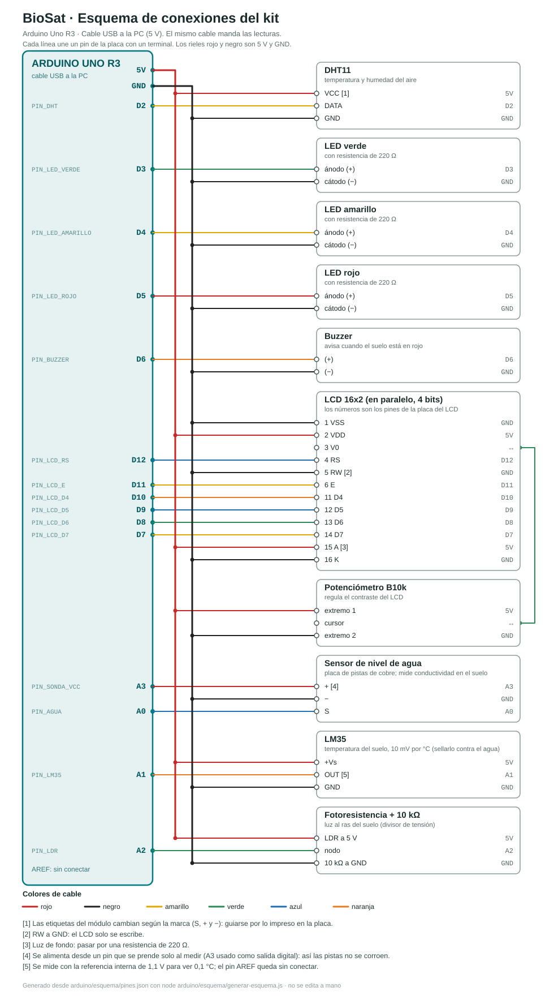

# Tabla de conexiones del kit

> Se genera sola desde [`pines.json`](pines.json) con `node arduino/esquema/generar-esquema.js`. No se edita a mano.

**Placa:** Arduino Uno R3. **Alimentación:** Cable USB a la PC (5 V). El mismo cable manda las lecturas.

**Piezas:** Hecho con las piezas de arduinocomponentes.webp: LCD 16x2 común (sin módulo I2C), sensor de nivel de agua, LM35, DHT11 en módulo, fotoresistencia, LEDs, buzzer, resistencias de 220 Ω y 10 kΩ, potenciómetro B10k, protoboard y cables.

## Por pin de la placa

| Pin | En el sketch | Va a | Cable |
|---|---|---|---|
| **5V** | — | DHT11 · VCC; LM35 · +Vs; Fotoresistencia + 10 kΩ · LDR a 5 V; LCD 16x2 (en paralelo, 4 bits) · 2 VDD; LCD 16x2 (en paralelo, 4 bits) · 15 A; Potenciómetro B10k · extremo 1 | rojo |
| **GND** | — | DHT11 · GND; LED verde · cátodo (−); LED amarillo · cátodo (−); LED rojo · cátodo (−); Buzzer · (−); Sensor de nivel de agua · −; LM35 · GND; Fotoresistencia + 10 kΩ · 10 kΩ a GND; LCD 16x2 (en paralelo, 4 bits) · 1 VSS; LCD 16x2 (en paralelo, 4 bits) · 5 RW; LCD 16x2 (en paralelo, 4 bits) · 16 K; Potenciómetro B10k · extremo 2 | negro |
| **D2** | `PIN_DHT` | DHT11 · DATA | amarillo |
| **D3** | `PIN_LED_VERDE` | LED verde · ánodo (+) | verde |
| **D4** | `PIN_LED_AMARILLO` | LED amarillo · ánodo (+) | amarillo |
| **D5** | `PIN_LED_ROJO` | LED rojo · ánodo (+) | rojo |
| **D6** | `PIN_BUZZER` | Buzzer · (+) | naranja |
| **D7** | `PIN_LCD_D7` | LCD 16x2 (en paralelo, 4 bits) · 14 D7 | amarillo |
| **D8** | `PIN_LCD_D6` | LCD 16x2 (en paralelo, 4 bits) · 13 D6 | verde |
| **D9** | `PIN_LCD_D5` | LCD 16x2 (en paralelo, 4 bits) · 12 D5 | azul |
| **D10** | `PIN_LCD_D4` | LCD 16x2 (en paralelo, 4 bits) · 11 D4 | naranja |
| **D11** | `PIN_LCD_E` | LCD 16x2 (en paralelo, 4 bits) · 6 E | amarillo |
| **D12** | `PIN_LCD_RS` | LCD 16x2 (en paralelo, 4 bits) · 4 RS | azul |
| **A0** | `PIN_AGUA` | Sensor de nivel de agua · S | azul |
| **A1** | `PIN_LM35` | LM35 · OUT | naranja |
| **A2** | `PIN_LDR` | Fotoresistencia + 10 kΩ · nodo | verde |
| **A3** | `PIN_SONDA_VCC` | Sensor de nivel de agua · + | rojo |

## Por componente

| Componente | Terminal | Pin | Cable | Nota |
|---|---|---|---|---|
| **DHT11** | VCC | 5V | rojo | Las etiquetas del módulo cambian según la marca (S, + y −): guiarse por lo impreso en la placa. |
|  | DATA | D2 | amarillo |  |
|  | GND | GND | negro |  |
| **LED verde** | ánodo (+) | D3 | verde |  |
|  | cátodo (−) | GND | negro |  |
| **LED amarillo** | ánodo (+) | D4 | amarillo |  |
|  | cátodo (−) | GND | negro |  |
| **LED rojo** | ánodo (+) | D5 | rojo |  |
|  | cátodo (−) | GND | negro |  |
| **Buzzer** | (+) | D6 | naranja |  |
|  | (−) | GND | negro |  |
| **LCD 16x2 (en paralelo, 4 bits)** | 1 VSS | GND | negro |  |
|  | 2 VDD | 5V | rojo |  |
|  | 3 V0 | Potenciómetro B10k · cursor | verde |  |
|  | 4 RS | D12 | azul |  |
|  | 5 RW | GND | negro | RW a GND: el LCD solo se escribe. |
|  | 6 E | D11 | amarillo |  |
|  | 11 D4 | D10 | naranja |  |
|  | 12 D5 | D9 | azul |  |
|  | 13 D6 | D8 | verde |  |
|  | 14 D7 | D7 | amarillo |  |
|  | 15 A | 5V | rojo | Luz de fondo: pasar por una resistencia de 220 Ω. |
|  | 16 K | GND | negro |  |
| **Potenciómetro B10k** | extremo 1 | 5V | rojo |  |
|  | cursor | LCD 16x2 (en paralelo, 4 bits) · 3 V0 | verde |  |
|  | extremo 2 | GND | negro |  |
| **Sensor de nivel de agua** | + | A3 | rojo | Se alimenta desde un pin que se prende solo al medir (A3 usado como salida digital): así las pistas no se corroen. |
|  | − | GND | negro |  |
|  | S | A0 | azul |  |
| **LM35** | +Vs | 5V | rojo |  |
|  | OUT | A1 | naranja | Se mide con la referencia interna de 1,1 V para ver 0,1 °C; el pin AREF queda sin conectar. |
|  | GND | GND | negro |  |
| **Fotoresistencia + 10 kΩ** | LDR a 5 V | 5V | rojo |  |
|  | nodo | A2 | verde |  |
|  | 10 kΩ a GND | GND | negro |  |
