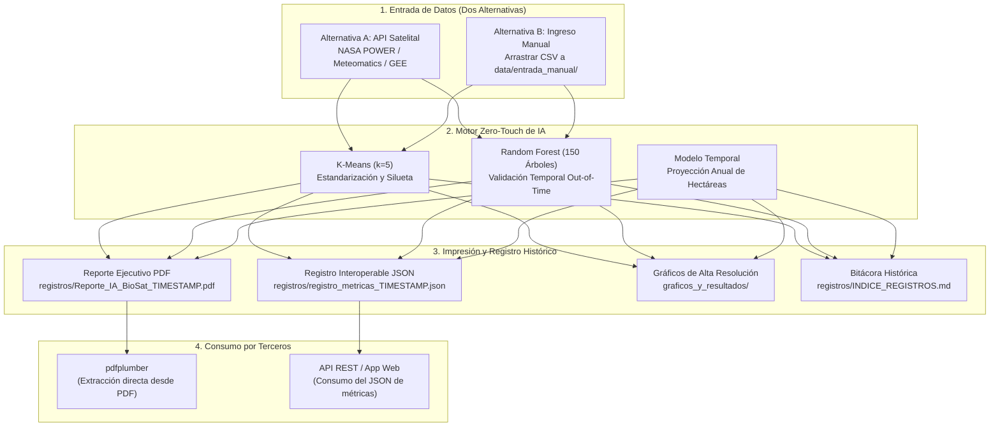

# 🛰️ Instrucciones de Operación del Pipeline Automatizado BioSat

> **Ubicación:** `santi-task/`  
> **Script Principal:** [`python/pipeline_automatizado.py`](file:///Users/santig56/Desktop/Nasa/santi-task/python/pipeline_automatizado.py)  
> **Carpeta de Reportes y Registros:** [`registros/`](file:///Users/santig56/Desktop/Nasa/santi-task/registros/)  
> **Filosofía:** *Zero-Touch* (el usuario solo ingresa datos y el pipeline se encarga del modelado, gráficos, resguardo y reporte en PDF).

---

## 1. Visión General del Flujo

El objetivo de este pipeline es que **cualquier actualización de datos satelitales, climáticos o edáficos se procese de forma inmediata y trazable**, generando un reporte imprimible en PDF con su correspondiente resguardo histórico, sin requerir intervención manual en el código de Machine Learning.



---

## 2. Las Dos Alternativas de Entrada de Datos

El pipeline admite dos formas flexibles de alimentar el sistema:

### Alternativa A: Automatizada mediante API Satelital
Ideal cuando se desea consultar de forma desatendida las APIs remotas oficiales:
- **Qué fuentes consulta:** NASA POWER API (clima diario y radiación) y Meteomatics API (pronóstico de alta resolución ECMWF IFS 9 km).
- **Cómo se ejecuta:**
  ```bash
  python3 santi-task/python/pipeline_automatizado.py --modo api
  ```
- **Ventaja:** Cero descargas manuales; el script hace la consulta HTTP, normaliza las respuestas y corre el modelo en un solo paso.

### Alternativa B: Ingreso Manual de Archivos desde Internet / GEE
Ideal cuando descargás capas desde Google Earth Engine (Google Drive), MapBiomas Chaco o portales gubernamentales:
- **Dónde se colocan los archivos:** En la carpeta [`santi-task/data/entrada_manual/`](file:///Users/santig56/Desktop/Nasa/santi-task/data/entrada_manual/) (o [`santi-task/data/gee_exports/`](file:///Users/santig56/Desktop/Nasa/santi-task/data/gee_exports/)).
- **Formatos soportados:** Archivos `.csv` con estadísticas zonales o píxeles estratificados.
- **Cómo se ejecuta:**
  ```bash
  python3 santi-task/python/pipeline_automatizado.py --modo manual
  ```
- **Ventaja:** Máxima compatibilidad con cualquier fuente offline o satélite nuevo.

*(Si ejecutás sin parámetros `python3 santi-task/python/pipeline_automatizado.py`, el modo `auto` detecta automáticamente si hay archivos nuevos en la bandeja manual; si no los hay, utiliza la base satelital activa).*

---

## 3. Procesamiento "Zero-Touch" (Qué hace el script por detrás)

El usuario **no necesita tocar nada más**:
1. Estandariza las 11 variables ambientales ($Z$-Score).
2. Ajusta el agrupamiento K-Means ($K=5$) y calcula la métrica de silueta.
3. Entrena el Random Forest sobre la partición temporal ($\le 2015$) y evalúa sobre desmonte real ($2016–2023$).
4. Extrae la jerarquía de importancia de variables y el score de riesgo por zona.
5. Reemplaza los 8 gráficos activos en [`graficos_y_resultados/`](file:///Users/santig56/Desktop/Nasa/santi-task/graficos_y_resultados/).

---

## 4. Reporte en PDF y Almacenamiento en `registros/`

El resultado principal del pipeline es un **Reporte de Auditoría en PDF de 2 páginas** almacenado en [`santi-task/registros/`](file:///Users/santig56/Desktop/Nasa/santi-task/registros/):

- **Nombre de archivo:** `Reporte_IA_BioSat_YYYYMMDD_HHMMSS.pdf`
- **Contenido del PDF:**
  - **Fecha y hora exacta** de la ejecución.
  - **Huella digital (Hash SHA-256)** de los datasets de entrada (garantiza trazabilidad ante el jurado o la cátedra).
  - **Tabla comparativa de métricas:** ROC-AUC, F1-Score, Exactitud y Kappa.
  - **Diagnóstico zonal:** Nivel de alerta por zona (ej. Zona 3 Copo: riesgo 0.58).
  - **Evidencia gráfica embebida:** Curvas ROC, gráfico de codo/silueta, heatmap y ponderación de variables.

Todas las versiones quedan preservadas cronológicamente en [`registros/INDICE_REGISTROS.md`](file:///Users/santig56/Desktop/Nasa/santi-task/registros/INDICE_REGISTROS.md) para comparar cómo evolucionan las métricas con nuevos datos.

---

## 5. Interoperabilidad: ¿Cómo consumen las métricas otros módulos?

Para asegurar que estos datos no queden aislados y puedan alimentar a la app web de Enzo o la presentación de Sara:

### Opción 1: Extracción directa desde el PDF con `pdfplumber`
Cualquier script puede leer el PDF recién generado:
```python
import pdfplumber

with pdfplumber.open("santi-task/registros/Reporte_IA_BioSat_ULTIMO.pdf") as pdf:
    texto = pdf.pages[0].extract_text()
    tablas = pdf.pages[0].extract_tables()
```
*(Podés probar el script utilitario listo: `python3 santi-task/python/extraer_metricas_pdf.py`)*.

### Opción 2: Consumo directo del JSON de métricas (Recomendado para APIs y Web)
Simultáneamente al PDF, el pipeline genera `registro_metricas_YYYYMMDD_HHMMSS.json` en `registros/`, conteniendo los valores numéricos limpios:
```json
{
  "timestamp": "2026-11-14 14:56:17",
  "fuente_datos": "Hansen GFC v1.11, TerraClimate & SoilGrids 2.0",
  "metricas": {
    "kmeans": { "k": 5, "silueta": 0.5631 },
    "random_forest": { "auc": 0.9726, "f1": 0.9026 },
    "riesgo_por_zona": { "zona_3_monte_semiarido": 0.58, "zona_1_riego_salitre": 0.08 }
  }
}
```
Esto permite conectar directamente un endpoint FastAPI, Node.js o importar desde la app en `BioSat/web/app.js`.
