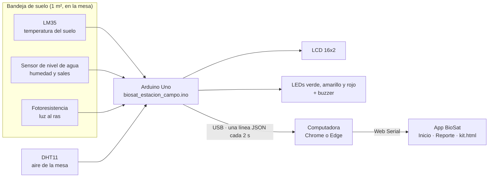
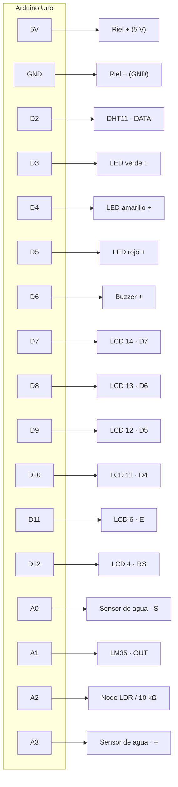
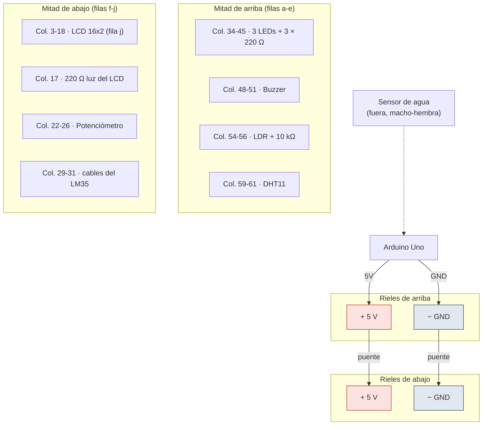
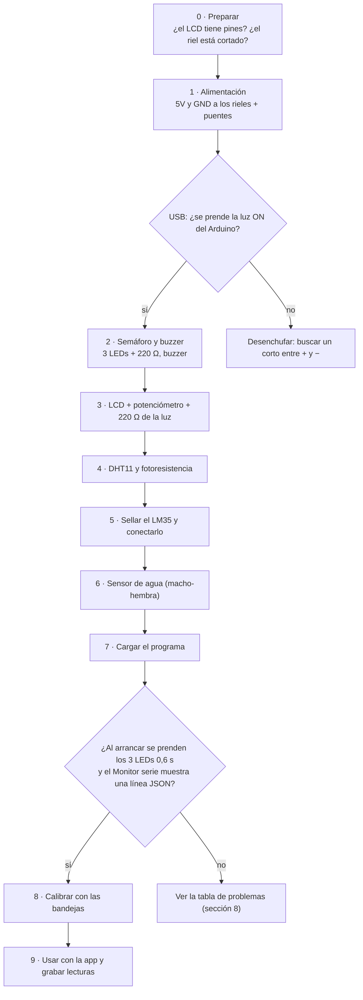
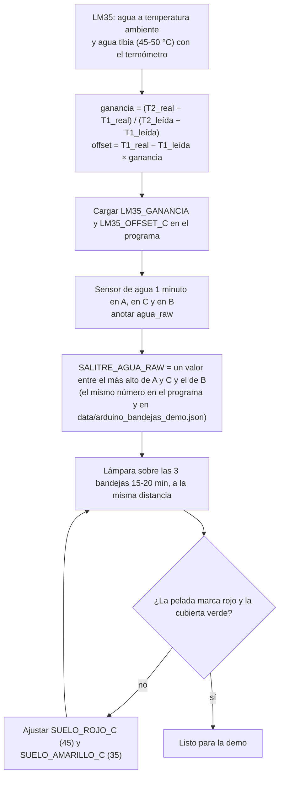
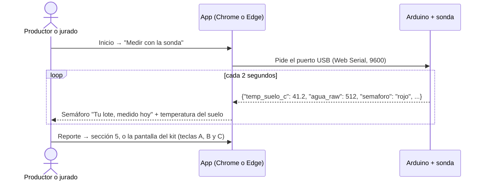

# Guía de armado en protoboard · Estación de campo BioSat

> **Para quien la ejecute (persona o agente):** esta guía alcanza para armar, probar y calibrar el kit sin preguntar nada. Los pines salen de [`esquema/pines.json`](esquema/pines.json), que es la **fuente única**: el programa ([`biosat_estacion_campo/biosat_estacion_campo.ino`](biosat_estacion_campo/biosat_estacion_campo.ino)) y la [tabla de conexiones](esquema/tabla-de-conexiones.md) ya coinciden con ella. Si cambiás un cable, cambiá `pines.json` y el `#define` del programa, y corré `node arduino/esquema/generar-esquema.js` y `node --test tests/*.test.js`.

## 1. La respuesta corta: sí, tu kit sirve para la app

Con las piezas del kit "para principiantes" (Arduino Uno) se arma la **estación de campo de BioSat**: mide **un metro cuadrado de suelo** y lo muestra al lado de lo que ve el satélite. **No hace falta comprar nada electrónico.**

**Cómo se conecta con la app que ya está publicada:**
- **Inicio**, botón **Medir con la sonda** (Chrome o Edge en una computadora): el semáforo deja de mostrar "Tu zona en {mes}" y pasa a **"Tu lote, medido hoy"**, con la temperatura del suelo que mide la sonda.
- **Reporte**, sección 5, **Lo que midió la sonda:** muestra la lectura en vivo, o las lecturas grabadas si no hay placa.
- **Pantalla del kit** (`web/kit.html`): las 3 bandejas para la mesa del jurado, con las teclas A, B y C.

**Lo que muestra y por qué importa:** el **suelo pelado se calienta varios grados más que el cubierto**, y el satélite (celdas de 50 km) no lo ve. Es el mensaje central de BioSat.

**Lo que no es:** un instrumento de campo. El sensor de "nivel de agua" no da % de humedad, sirve para **comparar** bandejas. El DHT11 tiene un error de ±2 °C. Para un lote real hay que pasar a la guía `web/campo.html` (ESP32 con LoRa).



## 2. Qué piezas del kit se usan

| # | Pieza del kit | ¿Se usa? | Para qué |
|---|---|---|---|
| 1 | Placa UNO | **Sí** | El cerebro. Se alimenta y manda datos por el USB |
| 18 | Cable USB A/B | **Sí** | Alimentación y datos |
| 13 | Protoboard de 830 puntos | **Sí** | Para armar sin soldar (ver 4) |
| 7, 17 | Cables macho-macho y macho-hembra | **Sí** | Macho-hembra para los módulos (DHT11 y sensor de agua) |
| 8 | LM35 | **Sí** | **Temperatura del suelo**: el sensor que más importa |
| 31 | Sensor de nivel de agua | **Sí** | Humedad y conductividad (sales) para comparar bandejas |
| 12 | Fotoresistencias | **Sí** (1) | Luz al ras del suelo |
| 34 | Módulo DHT11 | **Sí** | Temperatura y humedad del aire |
| 32 | Display LCD fondo azul (16x2 en paralelo) | **Sí** | Muestra las lecturas en la mesa |
| 35 | Potenciómetro B10k | **Sí** | Contraste del LCD |
| 33 | LEDs | **Sí** (verde, amarillo y rojo) | Semáforo del suelo |
| 3 | Buzzer | **Sí** (1) | Suena al pasar a rojo |
| 25 | Resistencias 220 Ω y 10 kΩ | **Sí** | 4 de 220 Ω (3 LEDs y la luz del LCD) y 1 de 10 kΩ (fotoresistencia) |
| 36 | Tira de pines 1x40 | **Solo si el LCD no trae pines** | Hay que soldar 16 pines al LCD para enchufarlo a la protoboard |
| 14 + 5 | Control remoto + receptor VS1838B | Opcional (sección 9) | Elegir la bandeja A, B o C desde un control remoto |
| 29 | Módulo RGB | Opcional | Podría reemplazar los 3 LEDs por una sola luz. No hace falta |
| 15 | Módulo RTC | No | La hora la pone la computadora |
| 18 (bis) | Módulo relé | No | Sin bomba de agua no aporta a la demo |
| 2, 16, 20 a 24, 26, 28, 30, 4, 6, 9 a 11, 27 | 74HC595, motor paso a paso y su controlador, displays de 7 segmentos, matriz 8x8, teclado 4x4, RFID, micrófono, servo, sensores IR, ball switch, pulsadores, joystick, adaptador de 9 V | No | No suman al mensaje de la app. Quedan para otros proyectos |

**Fuera del kit** (de la casa o de una ferretería):
- 3 recipientes de unos 20 × 30 cm;
- tierra;
- sal fina;
- rastrojo o paja seca;
- una lámpara incandescente o un velador (para calentar las bandejas);
- **termocontraíble o cinta aisladora y silicona** (para sellar el LM35);
- un termómetro de cocina o médico (para calibrar).

## 3. Mapa de conexiones (de qué pin a qué pieza)

| Pin del Arduino | Va a | Nota |
|---|---|---|
| **5V** | riel + de la protoboard | Alimenta todo lo de abajo |
| **GND** | riel − de la protoboard | Tierra común |
| **D2** | DHT11 · DATA (S) | |
| **D3, D4, D5** | LED verde, amarillo, rojo · pata larga (+) | La pata corta (−) va por una resistencia de **220 Ω** al riel − |
| **D6** | Buzzer (+) | El (−) va al riel − |
| **D7, D8, D9, D10** | LCD · pines 14 (D7), 13 (D6), 12 (D5), 11 (D4) | |
| **D11** | LCD · pin 6 (E) | |
| **D12** | LCD · pin 4 (RS) | |
| **A0** | Sensor de agua · S | |
| **A1** | LM35 · OUT (pata del medio) | El pin **AREF queda sin conectar** |
| **A2** | Nodo entre la fotoresistencia y la de 10 kΩ | |
| **A3** | Sensor de agua · + | El programa le da corriente **solo al medir**, así no se corroe |



## 4. Cómo es la protoboard y dónde va cada cosa

### 4.1 Cómo está conectada por dentro

Una protoboard de 830 puntos tiene:

- **4 rieles largos**, 2 arriba y 2 abajo, marcados **+** (rojo) y **−** (azul). Cada riel está conectado de punta a punta. **Ojo:** en algunas protoboards el riel está cortado a la mitad. Comprobalo con un cable o un tester.
- **63 columnas numeradas.** Cada columna tiene 2 grupos de 5 agujeros:
  - **a, b, c, d y e** (mitad de arriba), conectados entre sí;
  - **f, g, h, i y j** (mitad de abajo), conectados entre sí.
- **Una canaleta central** que separa las dos mitades: lo de arriba y lo de abajo **no** se tocan.

```text
   riel +  ++++++++++++++++++++++++++++++++++++++++++   (5 V)
   riel −  ------------------------------------------   (GND)
        a  o o o o o o o o o o o o o o o o o o o o ...
        b  o o o o o o o o o o o o o o o o o o o o      cada COLUMNA (a-e) es un solo cable
        c  o o o o o o o o o o o o o o o o o o o o
        d  o o o o o o o o o o o o o o o o o o o o
        e  o o o o o o o o o o o o o o o o o o o o
           ======== canaleta (no conecta) =========
        f  o o o o o o o o o o o o o o o o o o o o
        g  o o o o o o o o o o o o o o o o o o o o      cada COLUMNA (f-j) es otro cable
        h  o o o o o o o o o o o o o o o o o o o o
        i  o o o o o o o o o o o o o o o o o o o o
        j  o o o o o o o o o o o o o o o o o o o o
   riel +  ++++++++++++++++++++++++++++++++++++++++++   (5 V)
   riel −  ------------------------------------------   (GND)
           1 2 3 4 5 ...                         ... 63
```

### 4.2 Plan de ubicación

Se propone este reparto por zonas, con columnas de ejemplo. Si tu LCD o tus piezas no encajan, corré la zona unas columnas: lo que importa son las conexiones de la sección 3.

| Zona | Columnas | Mitad | Qué va |
|---|---|---|---|
| Alimentación | rieles | arriba y abajo | 5V del Arduino al riel + de arriba y GND al riel − de arriba. **2 puentes** unen los rieles de arriba con los de abajo (+ con + y − con −) |
| LCD | 3 a 18 | abajo, fila **j** | Los 16 pines del LCD, del pin 1 (columna 3) al 16 (columna 18). Los cables salen de las filas f a i de cada columna |
| Luz del LCD | 17 | abajo | Resistencia de 220 Ω entre la columna 17 (pin 15, A) y el riel + |
| Contraste | 22 a 26 | abajo | Potenciómetro: un extremo al riel +, el otro al riel − y el cursor a la columna 5 (pin 3, V0 del LCD) |
| Sonda LM35 | 29 a 31 | abajo | Los 3 cables largos del LM35 sellado: +Vs al riel +, OUT a A1 y GND al riel − |
| Semáforo | 34 a 45 | arriba | 3 LEDs, cada uno en 2 columnas (pata larga a la izquierda). De la pata corta, una resistencia de 220 Ω al riel − |
| Buzzer | 48 a 51 | arriba | (+) a D6 y (−) al riel − |
| Luz (LDR) | 54 a 56 | arriba | Fotoresistencia entre las columnas 54 y 56; un cable de la 54 al riel +; una de 10 kΩ de la 56 al riel −; un cable de la 56 a A2 |
| DHT11 | 59 a 61 | arriba | Módulo de 3 pines: + al riel +, − al riel − y S (DATA) a D2 |
| Sensor de agua | fuera de la protoboard | — | Cables macho-hembra: S a A0, + a A3 y − al riel − |



## 5. Armado paso a paso

> **Regla de oro: todo se conecta con el USB desenchufado.** Se enchufa recién en la verificación de cada fase.



### Fase 0 · Preparar
- [ ] Mirar si el LCD trae los 16 pines soldados. **Si no los trae**, soldar 16 pines de la tira 1x40, o pedirle a alguien que lo haga: sin pines, el LCD no hace buen contacto.
- [ ] Con un cable, comprobar que cada riel conecta de punta a punta. Si está cortado a la mitad, poner un puente en el corte.
- [ ] Separar las resistencias: **220 Ω** (rojo-rojo-marrón) × 4 y **10 kΩ** (marrón-negro-naranja) × 1.

### Fase 1 · Alimentación
- [ ] Cable rojo del **5V** del Arduino al **riel +** de arriba; cable negro del **GND** al **riel −** de arriba.
- [ ] Puentes: riel + de arriba con riel + de abajo, y riel − de arriba con riel − de abajo.
- [ ] **Verificar:** al enchufar el USB se prende la luz ON del Arduino y no se calienta nada. Desenchufar.

### Fase 2 · Semáforo y buzzer
- [ ] Cada LED con la **pata larga (+)** en una columna y la **corta (−)** en la siguiente.
- [ ] De la columna de la pata corta, una **resistencia de 220 Ω** al **riel −**.
- [ ] Cables de la pata larga: verde a **D3**, amarillo a **D4** y rojo a **D5**.
- [ ] Buzzer: (+), la pata marcada o la más larga, a **D6**, y (−) al **riel −**.

### Fase 3 · LCD
- [ ] LCD en la fila **j**, columnas 3 a 18 (pin 1 en la columna 3).
- [ ] **Pines de alimentación:**
  - pin 1 (VSS) al riel −;
  - pin 2 (VDD) al riel +;
  - pin 5 (RW) al riel −;
  - pin 16 (K) al riel −.
- [ ] **Pin 15 (A, luz de fondo)** al riel + **a través de una resistencia de 220 Ω**.
- [ ] **Potenciómetro:** un extremo al riel +, el otro al riel − y el **cursor (pata del medio) al pin 3 (V0)**.
- [ ] **Datos:**
  - pin 4 (RS) a **D12**;
  - pin 6 (E) a **D11**;
  - pin 11 (D4) a **D10**;
  - pin 12 (D5) a **D9**;
  - pin 13 (D6) a **D8**;
  - pin 14 (D7) a **D7**.
- Los pines 7 a 10 del LCD (D0 a D3) **quedan sin conectar**: se usa en modo de 4 bits.

### Fase 4 · DHT11 y fotoresistencia
- [ ] **DHT11:** seguir lo impreso en el módulo, porque el orden cambia según la marca. **+** al riel +, **−** al riel − y **S** a **D2**.
- [ ] **Fotoresistencia:** entre dos columnas. Una columna va al **riel +**; la otra columna es el **nodo**, que va con un cable a **A2** y con la **resistencia de 10 kΩ** al **riel −**.

### Fase 5 · LM35 sellado (la sonda que va a la tierra)
- [ ] Con la cara plana hacia vos, las patas son, de izquierda a derecha, **+Vs**, **OUT** y **GND**.
- [ ] Alargar cada pata con un cable de 30 a 50 cm, uno de cada color: rojo para +Vs, naranja para OUT y negro para GND.
- [ ] **Aislar cada unión** con termocontraíble o cinta, y **cubrir el cuerpo con silicona o termocontraíble** dejando la punta lo más fina posible. Sin sellar, la humedad y la sal hacen que lea cualquier cosa.
- [ ] En la protoboard: +Vs al **riel +**, OUT a **A1** y GND al **riel −**.
- [ ] **No conectar nada al pin AREF**: el programa usa la referencia interna de 1,1 V para ver décimas de grado.

### Fase 6 · Sensor de nivel de agua
- [ ] Con cables macho-hembra: **S** a **A0**, **+** a **A3** y **−** al **riel −**.
- [ ] El + va a **A3**, no a 5 V: el programa lo prende solo un instante al medir.

### Fase 7 · Cargar el programa
1. En el IDE de Arduino: **Herramientas → Placa → Arduino Uno**, y elegir el puerto.
2. **Bibliotecas:** `DHT sensor library` (Adafruit), `Adafruit Unified Sensor` y `LiquidCrystal`.
3. Abrir `arduino/biosat_estacion_campo/biosat_estacion_campo.ino` y **Subir**.
4. **Verificar:**
   - al arrancar, los 3 LEDs se prenden 0,6 s;
   - el LCD muestra texto (si se ven cuadrados, girar el potenciómetro);
   - el **Monitor serie a 9600** muestra una línea así cada 2 segundos:

```json
{"t":12345,"agua_raw":512,"temp_suelo_c":41.2,"temp_aire_c":33.0,"hum_aire_pct":28,"luz_raw":870,"semaforo":"rojo"}
```

5. **Cerrar el Monitor serie** antes de usar la app: el navegador y el IDE no pueden usar el puerto a la vez.

## 6. Calibrar con las bandejas

**Las 3 bandejas:**
- **A**, pelada y seca: tierra seca, sin nada encima.
- **B**, salitrosa: tierra mojada con agua bien salada.
- **C**, con rastrojo: tierra cubierta con paja o rastrojo.



## 7. Usarlo con la app y grabar lecturas reales



- **Inicio:** "Medir con la sonda" y elegir el puerto. El semáforo pasa a "Tu lote, medido hoy".
- **Pantalla del jurado:** https://enzopazzelli.github.io/BioSat/web/kit.html. Poner la sonda en una bandeja y apretar **A**, **B** o **C**. Guarda sola cuando la temperatura se estabiliza.
- **Plan B sin placa en la demo:** grabar lecturas **reales** de las 3 bandejas en `data/arduino_bandejas_demo.json`, con el formato de [`docs/contratos-de-datos.md`](../docs/contratos-de-datos.md) §6:
  - en `bandejas.A_pelada_seca`, `B_salitrosa` y `C_rastrojo`, una lista de líneas JSON copiadas del Monitor serie;
  - en `meta`, la fecha y el umbral de salitre.

  **Nunca inventar números**: si no se midió, la lista queda vacía.

## 7 bis. Variante con un sensor de humedad de tierra resistivo (15/11)

Si en lugar del sensor de nivel de agua se usa un **sensor de humedad de tierra resistivo**, hay que cargar **otro programa**: [`biosat_estacion_humedad_suelo/biosat_estacion_humedad_suelo.ino`](biosat_estacion_humedad_suelo/biosat_estacion_humedad_suelo.ino). El sensor es una horquilla con dos patas metálicas y un módulo con potenciómetro, con 4 pines: VCC, GND, DO y AO. El programa original queda igual.

| Pin del módulo | Va a | Por qué |
|---|---|---|
| VCC | **A3** | El programa lo prende solo mientras mide, así la horquilla no se corroe |
| GND | GND | — |
| AO | **A0** | La lectura analógica, en el mismo lugar que el sensor de nivel de agua |
| DO | sin conectar | Es un "seco/húmedo" fijado con el potenciómetro; no hace falta |

- **La lectura va al revés:** este sensor da **1023 con la horquilla seca** y baja al mojarse. El programa la invierte (`1023 − lectura`), así que `agua_raw` sigue siendo "más alto = más húmedo o más conductivo". La app, el semáforo, la pantalla del kit y el aviso de salitre no cambian.
- **Comprobar:** la horquilla al aire da `agua_raw` cerca de 0; metida en un vaso de agua, sube mucho; con agua salada, sube más.
- **Recalibrar `SALITRE_AGUA_RAW`** con las 3 bandejas (sección 6): el número de este sensor no es el mismo que el del sensor de nivel de agua.

## 8. Si algo no anda

| Síntoma | Qué mirar |
|---|---|
| No se prende nada / se calienta | Corto entre riel + y riel −: desenchufar y revisar los puentes |
| El LCD en blanco o con cuadrados | Potenciómetro (contraste), RW a GND y los 6 cables de datos; ¿tiene pines soldados? |
| Un LED no prende | Sentido del LED (la pata larga al pin) y su resistencia de 220 Ω al riel − |
| `temp_aire_c` en `null` | DHT11: cable S en D2 y el orden de pines impreso en el módulo |
| Temperatura del suelo muy alta o saltando | LM35 mal sellado, un cable suelto o **algo conectado a AREF** |
| `agua_raw` siempre en 0 | El + del sensor tiene que ir a **A3**; la sonda tiene que tocar la tierra |
| "Conectar" no hace nada en la app | ¿Chrome o Edge? ¿El Monitor serie del IDE está cerrado? En el celular la lectura por USB no está disponible |

## 9. Extra opcional: elegir la bandeja con el control remoto

Hacerlo **solo si lo anterior ya funciona**. Suma un detalle lindo en la mesa del jurado: cambiar de bandeja sin tocar la computadora.

- **Piezas:** el receptor **VS1838B** y el control remoto del kit (con su pila CR1220).
- **Conexión:** pin **OUT** del receptor a **A4** (usado como entrada digital; D13 se evita porque tiene el LED de la placa), **VCC** al riel + y **GND** al riel −.
- **Cambios de código, para el agente:**
  1. Sumar el receptor a `esquema/pines.json` y regenerar el esquema y la tabla.
  2. En el programa, sumar `#define PIN_IR A4`, la biblioteca `IRremote` y mapear las teclas **1, 2 y 3** del control a las bandejas **A, B y C**. Agregar el campo `"bandeja":"A"` a la línea JSON solo cuando cambia.
  3. En `web/kit-logica.js`, si la lectura trae `bandeja`, elegirla como si se hubiera apretado la tecla. Prueba nueva en `tests/kit-logica.test.js`.
  4. Documentar el campo `bandeja` en `docs/contratos-de-datos.md` §6 y la decisión en la bitácora.
- **Terminado cuando:** la tecla 2 del control cambia la pantalla del kit a la bandeja B y todas las pruebas siguen en verde.

## 10. Terminado cuando

- [ ] El Monitor serie muestra una línea JSON válida cada 2 segundos, con los 6 valores y el semáforo.
- [ ] El LCD muestra las lecturas y los LEDs siguen el semáforo; el buzzer suena al pasar a rojo.
- [ ] El LM35 está sellado y calibrado con 2 temperaturas: `LM35_GANANCIA` y `LM35_OFFSET_C` están cargados.
- [ ] El umbral de salitre está calibrado, y es el mismo número en el programa y en `data/arduino_bandejas_demo.json`.
- [ ] Con la lámpara, la bandeja A marca rojo o amarillo y la C, verde.
- [ ] En Chrome o Edge, el Inicio de la app muestra "Tu lote, medido hoy" y la pantalla del kit lee las 3 bandejas.
- [ ] Hay lecturas reales grabadas en `data/arduino_bandejas_demo.json` (el plan B) y la decisión está anotada en la bitácora.
