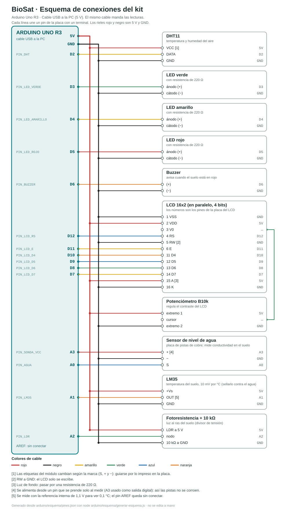

# Kit Arduino de BioSat

Una estación de campo en miniatura para la mesa del jurado. Mide **un metro cuadrado de suelo** (la bandeja) y lo muestra al lado de lo que el satélite ve para toda la zona: el aire a 50 km. Contrato de datos: [`docs/contratos-de-datos.md` §6](../docs/contratos-de-datos.md).



Tabla de cables, por pin y por componente: [`esquema/tabla-de-conexiones.md`](esquema/tabla-de-conexiones.md).

## Qué hay en esta carpeta

| Archivo | Para qué |
|---|---|
| **`GUIA-PROTOBOARD.md`** | **Guía de armado paso a paso en la protoboard, con diagramas, para una persona o un agente** |
| `biosat_estacion_campo/biosat_estacion_campo.ino` | El programa del Arduino. Una línea JSON cada 2 segundos, LCD y 3 LEDs |
| `lector-web-serial.js` | Lee el USB desde Chrome o Edge. La app lo carga sola |
| `esquema/pines.json` | **La fuente única** de los pines. De acá salen el esquema y la tabla |
| `esquema/generar-esquema.js` | Regenera el esquema y la tabla: `node arduino/esquema/generar-esquema.js` |
| `esquema/concepto-original.jpeg` | La imagen del plan inicial (con LCD I2C y otra sonda: no es la que se arma) |
| `esquema/componentes-disponibles.webp` | Las piezas que tiene el equipo |

Si hay que cambiar un cable: se edita `esquema/pines.json` **y** el `#define` del sketch, y se corre el generador. Las pruebas (`node --test tests/*.test.js`) avisan si el sketch, la tabla o el dibujo quedaron contando cosas distintas.

## Lo que mide y cómo leerlo

| Sensor | Pieza | Qué dice | Qué **no** dice |
|---|---|---|---|
| Temperatura del suelo | LM35 | Grados del suelo con 0,1 °C de resolución | Sin sellar, el agua lo estropea (ver abajo) |
| Humedad y conductividad | Sensor de nivel de agua | Qué tan fácil pasa la corriente entre sus pistas: sube con el agua **y** con las sales | No es un % de humedad. Sirve para **comparar bandejas**, no para regar |
| Luz | Fotoresistencia + 10 kΩ | Luz relativa al ras del suelo (0 a 1023) | No son lux |
| Aire | DHT11 | Temperatura (±2 °C) y humedad (±5 %) del aire de la mesa | No es el clima del lote |

**La demo en una frase:** el suelo pelado marca varios grados más que el cubierto y el satélite no lo ve. Por eso el sensor que más importa es el LM35.

## Armarlo

1. Conectar todo según el esquema. **Antes de cerrar nada**, mirar la tabla de cables y revisar 5 V y GND con el USB desconectado.
2. **Sellar el LM35.** Es un componente pelado de 3 patas: en suelo húmedo o con sal se corroe y lee cualquier cosa. Alargar las patas con cable, aislar cada unión con termocontraíble y cubrir el cuerpo con silicona o un tubito de termocontraíble, dejando una capa fina para que el calor pase. Ponerlo a **2 a 3 cm de profundidad** en cada bandeja.
3. **Contraste del LCD:** el potenciómetro regula las letras. Si se ven cuadrados negros, girarlo hasta que aparezca el texto.
4. **La luz de fondo (pin 15, A)** va por una resistencia de 220 Ω. Sin ella se acorta la vida del LCD.
5. **El módulo DHT11:** los pines vienen rotulados distinto según la marca (S, + y −). Seguir lo impreso en la placa, no el orden de la foto.

## Cargar el programa

1. En el IDE de Arduino: **Herramientas → Placa → Arduino Uno**, y elegir el puerto.
2. **Programa → Incluir biblioteca → Administrar bibliotecas** e instalar: `DHT sensor library` (Adafruit), `Adafruit Unified Sensor` y `LiquidCrystal`.
3. Abrir `biosat_estacion_campo.ino` y **Subir**. Al arrancar, los 3 LEDs se prenden 0,6 segundos: es la prueba de que están bien conectados.
4. Abrir el **Monitor serie a 9600**. Tiene que aparecer una línea así cada 2 segundos:

```json
{"t":12345,"agua_raw":512,"temp_suelo_c":41.2,"temp_aire_c":33.0,"hum_aire_pct":28,"luz_raw":870,"semaforo":"rojo"}
```

5. **Cerrar el Monitor serie** antes de usar la app: el navegador y el IDE no pueden leer el mismo puerto a la vez.

## Usarlo con la app

1. Abrir la pantalla del kit: https://enzopazzelli.github.io/BioSat/web/kit.html (en Chrome o Edge; no anda en Firefox).
2. **Conectar Arduino** y elegir el puerto.
3. Poner el sensor en una bandeja y apretar **A**, **B** o **C** en el teclado. La tarjeta guarda la lectura sola cuando la temperatura se estabiliza (menos de 0,3 °C de variación en 5 lecturas).
4. Se usa **un solo juego de sensores** que se pasa de bandeja en bandeja. La pantalla espera a que se estabilice.

## Calibrar (con las bandejas reales)

**1. Temperatura del suelo (LM35).** Cada placa tiene una referencia interna levemente distinta, y por eso el LM35 puede leer 1 o 2 °C de más o de menos.
- Medir con un termómetro bueno (de cocina o médico) dos temperaturas: agua a temperatura ambiente y agua tibia (45 a 50 °C), con el LM35 sellado dentro.
- Con las lecturas del Monitor serie calcular: `ganancia = (T2_real − T1_real) / (T2_leída − T1_leída)` y `offset = T1_real − T1_leída × ganancia`.
- Cargarlos en `LM35_GANANCIA` y `LM35_OFFSET_C` del sketch.

**2. Umbral de salitre (sensor de agua).** El número que separa "agua común" de "muy alta conductividad" depende de tu sensor.
- Dejar el sensor 1 minuto en la bandeja A (seca), en la C (con rastrojo) y en la B (con agua salada) y anotar `agua_raw`.
- Elegir un valor entre el más alto de A y C y el de B. Ponerlo en `SALITRE_AGUA_RAW` y en `data/arduino_bandejas_demo.json` → `meta.umbrales.conductividad_salitre_raw`. **Tiene que ser el mismo número en los dos lugares.** Si no está en el JSON, la pantalla usa 700.

**3. Semáforo.** `SUELO_ROJO_C` (45 °C) y `SUELO_AMARILLO_C` (35 °C) son un punto de partida. Ajustarlos para que la bandeja pelada caliente marque rojo y la cubierta, verde.

**4. Calentar las bandejas.** Dejar una lámpara incandescente o un velador sobre las bandejas 15 a 20 minutos antes de la demo, a la misma distancia. Sin calor, las tres marcan casi lo mismo y la pantalla lo dice ("casi lo mismo").

## Cómo medimos bien (lo que hace el sketch)

- **LM35 con referencia de 1,1 V:** con la de 5 V cada paso del conversor vale 0,5 °C; con 1,1 V, 0,1 °C. Por eso el pin AREF queda sin conectar. El sketch cambia de referencia solo y descarta las primeras lecturas, que salen mal.
- **Promedios:** 16 lecturas para la temperatura y 8 para los demás, para bajar el ruido.
- **La sonda se enciende solo al medir:** con corriente continua las pistas se corroen y la lectura se desvía con las horas.
- **Un sensor que falla se ve:** si el DHT11 no contesta, manda `null` (la app muestra "—"). Si el LM35 está fuera de rango, `null` y semáforo amarillo.

## Si algo no anda

| Síntoma | Qué mirar |
|---|---|
| El LCD se ve en blanco o con cuadrados | El potenciómetro de contraste; RW a GND; los 6 cables de datos |
| El botón "Conectar Arduino" no hace nada | ¿Navegador Chrome o Edge? ¿El Monitor serie del IDE está cerrado? |
| `temp_aire_c` en `null` | Cable de datos del DHT11 en D2 y su alimentación |
| Temperatura del suelo muy alta o saltando | El LM35 mal sellado, un cable suelto o el pin AREF conectado a algo |
| `agua_raw` siempre en 0 | El cable de la sonda (A3 es su alimentación) o la sonda sin tocar la tierra |
| Un LED no prende | El sentido del LED (la pata larga va al pin) y su resistencia de 220 Ω |

## Para el futuro: el kit en el campo

Esta estación depende de la PC por el cable USB. En un lote real se usaría una placa con radio (ESP32 con LoRa) y energía solar: ver la guía [`web/campo.html`](../web/campo.html). El formato de la línea no cambia.
