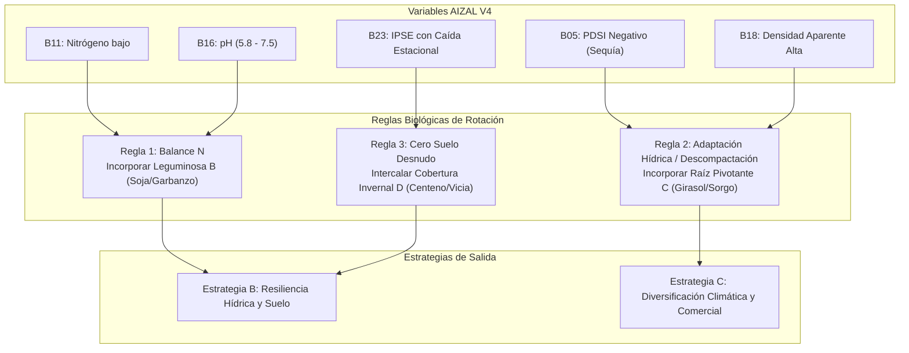

# Catálogo Maestro: Datos Cruzados AIZAL V4 y Motor Agronómico

> **Ubicación:** `data/datos_cruzados_aizal`  
> **Fuentes:** [AIZAL_Fichas_Variables_V4_2026.pdf](../../docs/AIZAL_Fichas_Variables_V4_2026.pdf) · [CONTEXTONASA.md](docs/CONTEXTONASA.md)  
> **Resolución Estándar del Cubo:** Grilla de 500 m en WGS84 (EPSG:4326) con remuestreo a 30 m vía Sentinel-2 / Landsat.

---

## 1. Arquitectura de Módulos

La base de variables de AIZAL V4 (38 capas raster + embeddings 64D) ha sido estructurada en **6 módulos temáticos** directamente integrados con los 5 Pilares Agronómicos del simulador de rotación:

| Módulo | Carpeta | Variables Clave | Pilar Agronómico Asociado |
| :--- | :--- | :--- | :--- |
| **1. Clima y Balance Hídrico** | [`01_Clima_y_Balance_Hidrico`](./01_Clima_y_Balance_Hidrico) | B01–B08 (ET, Lluvia, PDSI, Tmin, Tmax, Albedo) | **Pilar 1:** Balance Hídrico **Pilar 2:** Régimen Térmico y Luz |
| **2. Vegetación y Paisaje** | [`02_Vegetacion_Fenologia_y_Paisaje`](./02_Vegetacion_Fenologia_y_Paisaje) | B19–B23, B30, B31 (IPSE, Diversidad, Dist. Agro y Forestal) | **Pilar 5:** Dinámica de Dosel y Sanidad Vegetal |
| **3. Química y Nutrición** | [`03_Quimica_Nutricion_Suelo`](./03_Quimica_Nutricion_Suelo) | B09, B11, B13–B16 (Nitrógeno, pH, CIC, Carbono) | **Pilar 4:** Química y Nutrición del Suelo |
| **4. Física y Topografía** | [`04_Fisica_Suelo_y_Topografia`](./04_Fisica_Suelo_y_Topografia) | B10, B12, B17a/b, B18, B24, B25 (Textura, Dens. Aparente, DEM) | **Pilar 3:** Física, Anclaje y Riesgo de Erosión |
| **5. Logística y Antrópico** | [`05_Logistica_Antropico_y_Servicios`](./05_Logistica_Antropico_y_Servicios) | B26–B29, B32–B37 (Caminos, Población, Huella humana) | **Pilar 6:** Viabilidad Económica y Logística (<50 km) |
| **6. Embeddings IA** | [`06_Embeddings_IA_AlphaEarth`](./06_Embeddings_IA_AlphaEarth) | IA (AlphaEarth 64D - DeepMind 2024) | **Búsqueda de Análogos:** Transferencia de rotaciones exitosas |

---

## 2. Reglas de Rotación Disparadas por las Variables

---

## 3. Acceso a Datos y Archivos en Cada Carpeta

Cada una de las carpetas contiene:
1. `README.md`: Documentación técnica completa de cada variable, fórmula de procesamiento, resolución nativa y aplicación agronómica.
2. `variables.json`: Esquema estructurado y normalizado listo para ser consumido por scripts de Python, modelos de Machine Learning o APIs.
