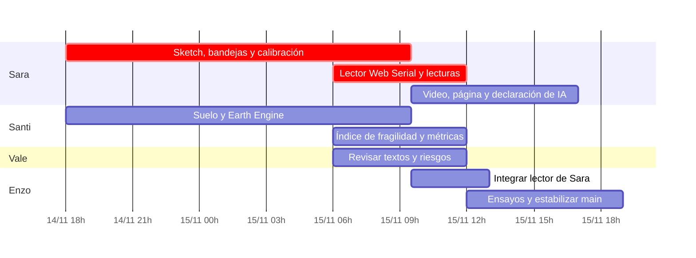

# Estado del proyecto BioSat

**Corte:** sábado 14/11/2026, tarde · **Rama:** `main` · **App publicada:** https://enzopazzelli.github.io/BioSat/web/

Este panorama se escribió a mano a partir de `main`, los planes de [`planes/`](../planes/README.md) y el contenido real de `data/`. El avance por persona se actualiza solo en el [README](../README.md).

---

## 1. En una mirada

| Frente | Quién | Estado | Qué hay | Qué falta |
|---|---|---|---|---|
| F1 · Clima | Enzo | **Listo** | `clima_zonas.json` completo (1981-2025, 5 zonas, ET0, normal contra reciente) | Nada |
| F5 · App y motor | Enzo | **Casi listo** | App publicada con calendario, 3 rotaciones, simulador, visor, desmonte, zonificación, pantalla del kit y guía del campo | Integrar el lector de Sara, ensayar la demo |
| F4 · Rotaciones | Vale | **Casi listo** | 15 rotaciones (5 zonas × 3). Zona 5 validada por un productor | Validar las zonas 1 a 4; revisar textos de la app; glosario |
| F2 · Suelo y zonificación | Santi | **A medias** | Zonificación AIZAL en 5 grupos, cargada | `suelo_zonas.json` y `diagnostico_landsat_ia.json` vacíos; visor de Earth Engine sin publicar |
| F3 · Modelo de desmontes | Santi | **Listo, con ajustes** | Modelo validado en el tiempo, riesgo y proyección por zona | Índice de fragilidad; revisar métricas (ver 4) |
| F6 · Arduino | Sara | **Sin empezar** | Nada en el repo | Sketch, lector Web Serial, bandejas, lecturas grabadas |
| F7 · Entrega | Sara (coordina) | **Sin empezar** | Nada | Guion, video o diapositivas, página del proyecto, ensayos |

Avance contado de las casillas de los planes: **Enzo 72%, Santi 44%, Vale 64%, Sara 4%** (53 de 108 casillas, 49%). Los porcentajes bajaron respecto de la versión anterior porque se sumaron 20 casillas que faltaban en los planes; no se perdió nada de lo hecho. Es una medida aproximada: no pesa igual cada tarea.

---

## 2. Qué funciona hoy en la app

Se verificó en Chrome sin internet, a 390 px de ancho y con 13 pruebas automáticas en verde.

- **Tu campo:** elegir una de las 5 zonas y las prioridades. Calendario de 12 meses con calor, heladas, lluvia y suelo pelado.
- **Rotaciones:** 3 por zona (actual y 2 alternativas) con evidencia, beneficios, qué falta saber y riesgos. Ordenadas con reglas visibles.
- **Simulador:** menos lluvia y más calor, de +0 a +2,5 °C.
- **Visor del lote:** imágenes Landsat de vista previa, 22 archivos.
- **Presión de desmonte y zonificación AIZAL:** nivel relativo por zona, serie anual y métricas del modelo.
- **Pantalla del kit** (`web/kit.html`): las 3 bandejas para la mesa del jurado. Hoy solo anda con el Arduino en vivo, porque no hay lecturas grabadas.
- **Guía "Del kit al campo"** (`web/campo.html`): una pantalla para el jurado.

### Qué datos están cargados

| Archivo | Con dato | Comentario |
|---|---|---|
| `clima_zonas.json` | 100% | NASA POWER |
| `rotaciones_santiago.json` | 100% | Vale; 1 de 5 zonas validada |
| `desmonte_zonas.json` | 100% | Santi |
| `zonificacion_aizal.json` | 100% | Santi |
| `suelo_zonas.json` | 0% (ninguna medición de las 55) | Plantilla vacía: la app muestra "sin dato" |
| `diagnostico_landsat_ia.json` | 0% (sin meses de suelo pelado) | Plantilla vacía: falta correr Earth Engine; la app dice "pendiente" |
| `arduino_bandejas_demo.json` | plantilla vacía | Lo carga Sara |

---

## 3. Lo que bloquea la demo

1. **El kit Arduino no tiene nada en el repo.** Sin sketch, sin lector (`arduino/lector-web-serial.js`) y sin lecturas grabadas, la pantalla del kit solo funciona si Sara llega con todo armado y conectado. Es el riesgo más grande: su plan está en 5% y es el frente que más tiempo físico necesita (armar y calibrar 3 bandejas).
2. **La entrega no empezó.** Falta el guion, el video o las diapositivas, la página del proyecto en Space Apps y la declaración de uso de IA. Solo Sara los tiene asignados.
3. **Faltan el suelo y el suelo pelado por Landsat** (`suelo_zonas.json` y `diagnostico_landsat_ia.json`). Hoy la app los muestra como "sin dato" o "pendiente": el panel de suelo está vacío.

---

## 4. Alertas y cosas para revisar

**Urgente**

- **Hay una contraseña escrita en el código de un repo público.** Está en `scripts/descargar_meteomatics.py` (cuenta de Meteomatics de Santi). Aunque se borre ahora, queda en el historial de Git. Hay que **cambiarla en Meteomatics** y hacer que el script la lea de una variable de entorno. Es de Santi, pero no puede esperar.

**Para confirmar con el equipo**

- **Permiso del productor:** la entrevista dice que falta confirmar por escrito que se puede nombrar el campo y usar sus frases. El plan de Vale ya pasó una frase al pitch. Conviene tener la confirmación antes de usarla.
- **Validación de la Zona 5:** sale de un audio de un productor. Está bien como "revisada por un productor", pero no como validación del INTA.
- **`requiere_hacienda`:** lo completó Enzo según el texto de cada rotación (7 en `true`). Vale debe confirmarlo.
- **Métricas del modelo:** el plan de Santi dice regresión logística AUC 0,986 y random forest AUC 0,973; `desmonte_zonas.json` dice 0,984 y 0,971. Hay que dejar un solo juego de números. También: el plan nombra una silueta de 0,563 y `zonificacion_aizal.json` la tiene en `null`.
- **Zonas 1 a 4 de Vale:** siguen "sin validar", y la app lo avisa. La confianza queda en "baja".
- **Qué predice la IA:** el modelo de Santi predice desmontes por zona. El suelo pelado sale por umbral, no por IA. Conviene decirlo así en el pitch.

---

## 5. Qué se resolvió hoy

- Clima 1981-2025 corregido y las 5 zonas cargadas (D-24, D-26).
- Zonificación AIZAL y modelo de desmontes, a partir de la propuesta de la profesora (D-25).
- Pantalla del kit para la mesa del jurado, guía del campo y Arduino Uno por USB para la demo (D-27).
- Integración a `main` de las ramas de Enzo, Santi y Vale. La de Sara no tiene commits.

---

## 6. Ruta hasta la entrega

Hitos de los planes: **Checkpoint 2** domingo 09:30, **congelamiento** domingo 15:00, **entrega** domingo 19:00.

---

## 7. Casillas abiertas de cada plan

La lista completa, por persona, está en el [README](../README.md#lo-que-falta-por-persona) y sale sola de los planes. Incluye las tareas que se sumaron en el repaso del 14/11 (marcadas "Agregadas por Enzo"): cada uno decide si corresponden.

---

## 8. Decisiones que necesita el equipo

1. **Plan B para el kit:** si el lector o las bandejas no llegan a tiempo, ¿se graban lecturas a mano en `arduino_bandejas_demo.json` y se muestra la pantalla del kit con "lectura grabada"? La pantalla ya lo soporta, pero los números tienen que ser reales y estar marcados como tales.
2. **Quién cubre a Sara en la entrega:** hoy Sara tiene el 100% de las tareas de la entrega.
3. **Cómo se presenta la IA:** igual que arriba, que el equipo cuente lo mismo en el video y en la página.
