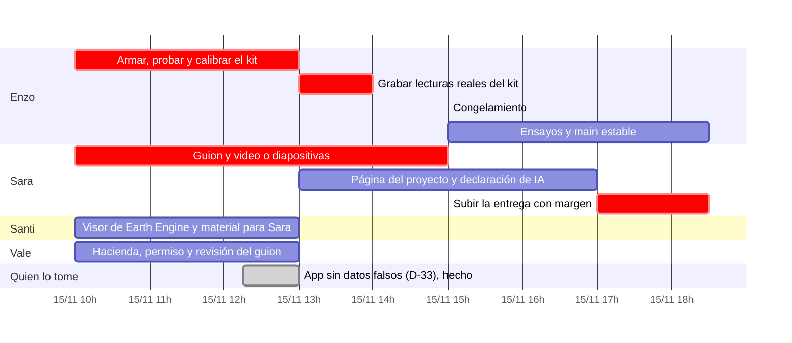

# Estado del proyecto BioSat

**Corte:** domingo 15/11/2026, 10:00 · **Rama:** `main` · **App publicada:** https://enzopazzelli.github.io/BioSat/web/

Este panorama se escribió a mano a partir de `main`, los planes de [`planes/`](../planes/README.md) y el contenido real de `data/`. El avance por persona se actualiza solo en el [README](../README.md).

---

## 1. En una mirada

| Frente | Quién | Estado | Qué hay | Qué falta |
|---|---|---|---|---|
| F1 · Clima | Enzo | **Listo** | `clima_zonas.json` completo (1981-2025, 5 zonas, ET0, normal contra reciente) | Nada |
| F5 · App y motor | Enzo | **Listo** | Inicio simple para el celular, Reporte completo con PDF y vista detallada (D-31). Probado en un celular de verdad (Enzo, 15/11: se ve bien). En la PC, el Inicio va en dos columnas, y el pronóstico de Meteomatics de los próximos días aparece en el Inicio, el Reporte y la pantalla del kit (D-34) | Probar la app publicada sin internet en el celular después del último merge; ensayar la demo en la pantalla grande |
| F4 · Rotaciones | Vale | **Casi listo** | 15 rotaciones (5 zonas × 3). Zona 5 revisada por un productor | Validar las zonas 1 a 4 (o decir que no lo están); confirmar `requiere_hacienda` y el permiso del productor; corregir un dato de la evidencia de la Zona 5; revisar el guion |
| F2 · Suelo y zonificación | Santi + Enzo (D-30) | **Listo, con datos reales** | Zonificación AIZAL en 5 grupos, suelo de SoilGrids 0-30 cm y meses de suelo pelado con Landsat 2021-2025 | Publicar el visor de Earth Engine; sumar lo que responda la profesora. Los 5 grupos ya tienen nombre y la app ya presenta bien el dato del satélite (D-33, rama `enzo-d33`, falta integrarla) |
| F3 · Modelo de desmontes | Santi + Enzo (D-30) | **Listo, con datos reales** | Random forest validado en el tiempo, riesgo y proyección por zona, índice de fragilidad con fórmula visible | Pasarle a Sara las métricas reales, el mapa de riesgo y la comparación 2000 contra 2025 |
| F6 · Arduino | Sara (en un simulador web) y Enzo | **Código listo, armado en curso** | Sketch compilado, lector Web Serial sumado a la app y probado con un puerto simulado, esquema y guía de armado en protoboard con el kit para principiantes (D-32). El 15/11 Sara lo está armando en un simulador web; Enzo avanzó con el kit el 14/11 | Probar en la placa real, calibrar y grabar lecturas reales. Si la demo usa el simulador, sus lecturas son simuladas y la pantalla del kit tiene que decirlo (D-33) |
| F7 · Entrega | Sara (coordina) | **Sin empezar** | Nada | Guion, video o diapositivas, página del proyecto, declaración de IA, ensayos |

Avance contado de las casillas de los planes: **Enzo 80%, Santi 81%, Vale 77%, Sara 20%** (81 de 120 casillas, 68%). Los planes pasaron de 108 a 120 casillas desde el corte del sábado; entre las nuevas están las de la app para el celular (D-31). Las 3 casillas del armado del kit están en el plan de Sara, pero las hace Enzo. Es una medida aproximada: no pesa igual cada tarea.

---

## 2. Qué funciona hoy en la app

Las **154 pruebas automáticas de la app** (`node --test "tests/*.test.js"`) están en verde, con D-33 incluido. La versión nueva se revisó a 390 px con `scripts/captura-movil.mjs` y en un celular de verdad. **Falta probarla sin internet en el celular.**

- **Asistente de inicio:** 4 preguntas con el mapa real de Santiago del Estero. La pregunta 1 nombra la característica de la zona y abajo sus localidades.
- **Inicio** (`web/index.html`): semáforo de la zona en el mes actual (o de la sonda, después de medir), lo que mejor encaja con la próxima siembra y la tira de 12 meses, y la barra con Medir con la sonda y WhatsApp.
- **Reporte** (`#reporte`): 7 secciones, cada una con su conclusión como título y un plegable "Para tu ingeniero". Guardar PDF y Compartir.
- **Vista detallada** (`web/completo.html`): la página de antes, con todo lo que tenía:
  - **Tu campo:** zona, prioridades y calendario de 12 meses con calor, heladas, lluvia y suelo pelado.
  - **Rotaciones:** 3 por zona, con evidencia, beneficios, qué falta saber y riesgos, ordenadas con reglas visibles.
  - **Simulador:** menos lluvia y más calor, de +0 a +2,5 °C.
  - **Visor del lote:** 21 compuestos Landsat de Earth Engine y el mapa de la zonificación (D-30).
  - **Presión de desmonte y zonificación AIZAL:** nivel relativo por zona, serie anual y métricas del modelo.
- **Pantalla del kit** (`web/kit.html`): las 3 bandejas para la mesa del jurado. Hoy solo anda con el Arduino en vivo, porque no hay lecturas grabadas.
- **Guía "Del kit al campo"** (`web/campo.html`): una pantalla para el jurado.

### Qué datos están cargados

| Archivo | Con dato | Comentario |
|---|---|---|
| `clima_zonas.json` | Completo | NASA POWER |
| `rotaciones_santiago.json` | Completo | Vale; 1 de 5 zonas revisada por un productor |
| `desmonte_zonas.json` | Completo | Hansen v1.13 y modelo de D-30 |
| `zonificacion_aizal.json` | Completo | Los 5 grupos tienen nombre desde D-33 (los propuso Vale y se verificaron contra el mapa) |
| `suelo_zonas.json` | Completo | SoilGrids 0-30 cm, con rango y confianza media (D-30). El monte nativo tiene valor en las 5 zonas (de 20 % a 61 %); su mediana y su rango quedan en `null` porque no se aplican a un porcentaje de área |
| `diagnostico_landsat_ia.json` | Casi completo | Meses de lotes sin cobertura vegetal activa (suelo descubierto o rastrojo seco) con Landsat 2021-2025 y fragilidad (D-30). **El umbral de NDVI no tiene exactitud ni F1 medidos** (en `null`, porque no hay datos de campo), y el resultado depende mucho del umbral: desde D-33 la app lo dice |
| `arduino_bandejas_demo.json` | Plantilla vacía | La carga quien arme el kit (hoy, Enzo) |

Los `null` se muestran en la app como "sin dato". No hay que rellenarlos a mano: o salen de una fuente, o quedan así.

---

## 3. Lo que bloquea la demo

1. **El kit está programado, pero no armado ni probado en la placa.** El sketch compila y el lector funciona con un puerto simulado. Según D-32, el kit para principiantes alcanza y no hace falta comprar nada electrónico. Falta armarlo con `arduino/GUIA-PROTOBOARD.md`, sellar el LM35, calibrar y grabar lecturas reales en `data/arduino_bandejas_demo.json`. Es lo que más tiempo físico necesita y no se puede hacer desde la PC.
2. **La entrega no empezó.** Falta el guion, el video o las diapositivas, la página del proyecto en Space Apps y la declaración de uso de IA. Solo Sara los tiene asignados, y quedan 9 horas.
3. ~~**La app muestra cosas que no son ciertas (D-33).**~~ **Arreglado en la rama `enzo-d33` (15/11), falta integrarlo a `main` antes del congelamiento.** La app dice "sin cobertura vegetal activa (suelo descubierto o rastrojo seco)", la tabla de métodos muestra solo el umbral de NDVI con "sin medir", no nombra MapBiomas, LART ni CNN, y los grupos tienen nombre. Detalle en la bitácora (D-33).

---

## 4. Alertas y cosas para revisar

**Decidido**

- **Contraseña de Meteomatics (D-29):** el script ya la lee de una variable de entorno y no está en el código. La clave vieja queda en el historial de Git y, **por practicidad, no se cambia**: es la cuenta del hackathon y Meteomatics no entra en la app. Si se viera un uso indebido, se cambia en ese momento.

**Para confirmar con el equipo**

- **Permiso del productor:** la entrevista dice que falta confirmar por escrito que se puede nombrar el campo y usar sus frases. El plan de Vale ya pasó una frase al pitch. Conviene tener la confirmación antes de usarla.
- **Validación de la Zona 5:** sale de un audio de un productor. Está bien como "revisada por un productor", pero no como validación del INTA.
- **`requiere_hacienda`:** lo completó Enzo según el texto de cada rotación (7 en `true`). Vale debe confirmarlo.
- **Métricas del modelo (D-30):** las del prototipo (AUC 0,986) eran de datos simulados. Las reales: random forest con AUC 0,78 en validación cruzada y 0,63 en la prueba 2016-2025, con una tasa base del 9 %. Detalle e interpretación en `docs/datos-y-metodos.md`. **Santi y Sara: usar solo esas en el pitch.**
- **Zonas 1 a 4 de Vale:** siguen "sin validar", y la app lo avisa. La confianza queda en "baja".
- **Qué predice la IA:** el modelo de Santi predice desmontes por zona. El suelo pelado sale por umbral, no por IA, y ese umbral no tiene exactitud medida. Conviene decirlo así en el pitch.
- **Semáforo del Inicio (D-31):** los umbrales son un criterio del equipo, no una norma agronómica. La app lo dice; el pitch también debería decirlo.
- **Pronóstico de Meteomatics (D-34):** el secreto `METEOMATICS_PASSWORD` ya está cargado. El workflow corrió bien el 15/11 a las 11:06 y desde ahí renueva el pronóstico todos los días a las 06:00. Si la cuenta del hackathon vence, el workflow falla en rojo y, cuando no le quedan días, la tarjeta dice "Pronóstico vencido". Pendiente de Santi: el viento promedio de 24 h y el período de la alerta de helada.
- **Kit en el simulador web:** si en la demo se muestra el kit del simulador, las lecturas son simuladas. Para no mostrar cosas falsas (D-33), la pantalla del kit tiene que aclararlo.

---

## 5. Qué se resolvió

**Sábado 14/11**

- Clima 1981-2025 corregido y las 5 zonas cargadas (D-24, D-26).
- Zonificación AIZAL y modelo de desmontes, a partir de la propuesta de la profesora (D-25).
- Pantalla del kit para la mesa del jurado, guía del campo y Arduino Uno por USB para la demo (D-27).
- Integración a `main` de las ramas de Enzo, Santi y Vale.

**Domingo 15/11, madrugada y mañana**

- Datos reales de Earth Engine en lugar del prototipo simulado: suelo, desmontes, zonificación, suelo pelado e imágenes (D-30).
- App para el celular: Inicio simple, Reporte completo con PDF, vista detallada y asistente corregido (D-31), integrada en `main` y probada en un celular.
- Guía de armado en protoboard con el kit para principiantes (D-32).
- Revisión de ramas: `santi-datos-ia`, `vale-rotaciones` y `sara-arduino-entrega` no tienen nada fuera de `main`, y `enzo-app` quedó integrada entera.
- El Inicio en dos columnas en la PC y el pronóstico de Meteomatics en la app, con actualización diaria (D-34).
- Botón de idioma ES/EN, etapa 1: el asistente, el Inicio, el marco del Reporte, el kit y la guía del campo en inglés, con `?lang=en` para mandar el link a un jurado (D-35).
- La app ya no muestra cosas que no son ciertas (D-33): "sin cobertura vegetal activa" con el texto de Vale, la tabla de métodos real, sin fuentes falsas y los 5 grupos con nombre. En la rama `enzo-d33`.

---

## 6. Ruta hasta la entrega

Propuesta desde las 10:00 del domingo. El Checkpoint 2 (09:30) ya pasó. El equipo la ajusta.

Hitos de los planes: **congelamiento** domingo 15:00, **entrega** domingo 19:00.

---

## 7. Casillas abiertas de cada plan

La lista completa, por persona, está en el [README](../README.md#lo-que-falta-por-persona) y sale sola de los planes. Incluye las tareas que se sumaron en el repaso del 14/11 (marcadas "Agregadas por Enzo"): cada uno decide si corresponden.

---

## 8. Decisiones que necesita el equipo

1. **Plan B para el kit:** si el armado no llega a tiempo, ¿se graban lecturas a mano en `arduino_bandejas_demo.json` y se muestra la pantalla del kit con "lectura grabada"? La pantalla ya lo soporta, pero los números tienen que ser reales y estar marcados como tales.
2. **Quién cubre a Sara en la entrega:** hoy Sara tiene el 100% de las tareas de la entrega y no empezó ninguna.
3. **Cómo se presenta la IA:** igual que arriba, que el equipo cuente lo mismo en el video y en la página.
