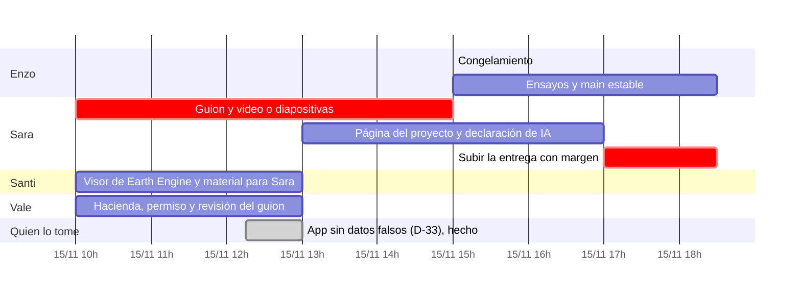

# Estado del proyecto BioSat

**Corte:** domingo 15/11/2026, 13:00 (se sumaron D-33, D-36 y D-37, la hoja de ruta del ingeniero; el avance de la entrega no se volvió a relevar desde las 10:00). **20:00: el kit Arduino se archivó y el dron tomó su lugar en el Inicio (D-44)** · **Rama:** `main` · **App publicada:** https://enzopazzelli.github.io/BioSat/web/

Este panorama se escribió a mano a partir de `main`, los planes de [`planes/`](../planes/README.md) y el contenido real de `data/`. El avance por persona se actualiza solo en el [README](../README.md).

---

## 1. En una mirada

| Frente | Quién | Estado | Qué hay | Qué falta |
|---|---|---|---|---|
| F1 · Clima | Enzo | **Listo** | `clima_zonas.json` completo (1981-2025, 5 zonas, ET0, normal contra reciente) | Nada |
| F5 · App y motor | Enzo | **Listo** | Inicio simple para el celular, Reporte completo con PDF y vista detallada (D-31). Probado en un celular de verdad (Enzo, 15/11: se ve bien). En la PC, el Inicio va en dos columnas, y el pronóstico de Meteomatics de los próximos días aparece en el Inicio, el Reporte y la pantalla del kit (D-34). Botón ES/EN (D-35). Desde D-44, el dron es el dato de hoy del lote en el Inicio (tarjeta y botón "Abrir un vuelo de dron", en el lugar de la sonda). Sin datos falsos (D-33) y el visor del Reporte vuelve a mostrar la imagen Landsat (D-36), publicados el 15/11 a las 12:40 | Probar la app publicada sin internet en el celular después del último merge; ensayar la demo en la pantalla grande |
| F4 · Rotaciones | Vale | **Casi listo** | 15 rotaciones (5 zonas × 3). Zona 5 revisada por un productor | Validar las zonas 1 a 4 (o decir que no lo están); confirmar `requiere_hacienda` y el permiso del productor; corregir un dato de la evidencia de la Zona 5; revisar el guion |
| F2 · Suelo y zonificación | Santi + Enzo (D-30) | **Listo, con datos reales** | Zonificación AIZAL en 5 grupos, suelo de SoilGrids 0-30 cm y meses de suelo pelado con Landsat 2021-2025 | Publicar el visor de Earth Engine; sumar lo que responda la profesora. Los 5 grupos ya tienen nombre y la app ya presenta bien el dato del satélite (D-33, en `main` y publicado) |
| F3 · Modelo de desmontes | Santi + Enzo (D-30) | **Listo, con datos reales** | Random forest validado en el tiempo, riesgo y proyección por zona, índice de fragilidad con fórmula visible | Pasarle a Sara las métricas reales, el mapa de riesgo y la comparación 2000 contra 2025 |
| F6 · Arduino | — | **Archivado (D-44)** | Todo lo del kit quedó en [`archivo/kit-arduino/`](../archivo/kit-arduino/README.md): programas del Uno y del ESP32, lector Web Serial, esquema, guías, pantalla del kit y guía "Del kit al campo". La app ya no lo carga ni lo enlaza | Nada. El dato de hoy del lote sale del vuelo del dron (tarjeta "Tu lote, desde el dron" en el Inicio). Si se retoma, el README del archivo dice qué sacar y dónde volver a ponerlo |
| F7 · Entrega | Sara (coordina) | **Sin empezar** | Nada | Guion, video o diapositivas, página del proyecto, declaración de IA, ensayos |

Avance contado de las casillas de los planes: **Enzo 86%, Santi 76%, Vale 72%, Sara 26%** (99 de 136 casillas, 73%), según el README del 15/11 a las 20:00. Con D-44, las 8 casillas del kit que estaban sin hacer (7 de Sara, 1 de Enzo) se tacharon y ya no cuentan: por eso sube el porcentaje de Sara sin que haya avanzado la entrega. Es una medida aproximada: no pesa igual cada tarea.

---

## 2. Qué funciona hoy en la app

Las **189 pruebas automáticas de la app** (`node --test "tests/*.test.js"`) y las 48 de `ia_desmonte/pruebas` están en verde, con D-33, D-36 a D-41 y D-44 incluidos (bajaron de 227 porque las del kit se archivaron con él). La versión nueva se revisó a 390 px con `scripts/captura-movil.mjs` y en un celular de verdad. **Falta probarla sin internet en el celular.**

- **Asistente de inicio:** 4 preguntas con el mapa real de Santiago del Estero. La pregunta 1 nombra la característica de la zona y abajo sus localidades (5 por zona desde D-45).
- **Inicio** (`web/index.html`): semáforo de la zona en el mes actual (lo típico), la tarjeta **"Tu lote, desde el dron"** (D-44: fecha del vuelo, NDVI mediano, % sin cobertura activa y sectores para revisar; si el vuelo es de otro mes, lo dice), lo que mejor encaja con la próxima siembra y la tira de 12 meses, y la barra con "Abrir un vuelo de dron" y WhatsApp.
- **Reporte** (`#reporte`): 6 secciones (la de la sonda se archivó con el kit, D-44), cada una con su conclusión como título y un plegable "Para tu ingeniero". Guardar PDF y Compartir.
- **Vista detallada** (`web/completo.html`): la página de antes, con todo lo que tenía:
  - **Tu campo:** zona, prioridades y calendario de 12 meses con calor, heladas, lluvia y suelo pelado.
  - **Rotaciones:** 3 por zona, con evidencia, beneficios, qué falta saber y riesgos, ordenadas con reglas visibles.
  - **Simulador:** menos lluvia y más calor, de +0 a +2,5 °C.
  - **Visor del lote:** 21 compuestos Landsat de Earth Engine y el mapa de la zonificación (D-30).
  - **Presión de desmonte y zonificación AIZAL:** nivel relativo por zona, serie anual y métricas del modelo.
- ~~**Pantalla del kit** y **guía "Del kit al campo"**~~: archivadas en `archivo/kit-arduino/web/` (D-44).
- **Imagen de dron (D-38, etapa 1, en la rama `enzo-dron`):** en la sección 4 del Reporte se abre un .tif de dron, que se ve sobre el mapa y se compara con Landsat. Si la cámara lo permite, muestra el NDVI del lote al lado de lo que Landsat dice de la zona, y una línea en el Inicio. El archivo no sale del equipo. Probado con un .tif real (foto RGB de 33,6 MB, se lee en menos de 2 s). Falta probarlo en un celular de verdad.
- **Clases del ingeniero (D-41, en la rama `enzo-clases`):** el NDVI del vuelo se clasifica con los cortes y los nombres que carga el ingeniero en la app (por ejemplo, maleza, zona afectada y vigoroso): % del lote y de cada sector, capa y leyenda. Faltan sus cortes reales.
- **Satélite del lote (D-40, en la rama `enzo-satelite-lote`):** el visor dice la resolución real de Landsat (unos 120 m por píxel, no 30 m). Si el vuelo del dron cae sobre un recorte satelital del lote, se ven Sentinel-2 (10 m) y Landsat (30 m) de una pasada cercana al vuelo, con la cortina y la comparación del NDVI en la misma superficie. El recorte real del lote de la Zona 1 ya está (julio de 2026): NDVI 0,42 con el dron, 0,22 con Sentinel-2 y 0,28 con Landsat.
- **Sectores del lote (D-39, etapa 2 del dron, en `main`):** se marcan sectores sobre el mapa, cada uno con superficie, NDVI, nota, estado (para revisar, revisado o descartado) y "Qué se encontró". El vuelo y los sectores quedan guardados en el navegador para el campo sin internet. Se exportan e importan en GeoJSON. Falta probarlo con el `NDVI.tif` real.

### Qué datos están cargados

| Archivo | Con dato | Comentario |
|---|---|---|
| `clima_zonas.json` | Completo | NASA POWER |
| `rotaciones_santiago.json` | Completo | Vale; 1 de 5 zonas revisada por un productor |
| `desmonte_zonas.json` | Completo | Hansen v1.13 y modelo de D-30 |
| `zonificacion_aizal.json` | Completo | Los 5 grupos tienen nombre desde D-33 (los propuso Vale y se verificaron contra el mapa) |
| `suelo_zonas.json` | Completo | SoilGrids 0-30 cm, con rango y confianza media (D-30). El monte nativo tiene valor en las 5 zonas (de 20 % a 61 %); su mediana y su rango quedan en `null` porque no se aplican a un porcentaje de área |
| `diagnostico_landsat_ia.json` | Casi completo | Meses de lotes sin cobertura vegetal activa (suelo descubierto o rastrojo seco) con Landsat 2021-2025 y fragilidad (D-30). **El umbral de NDVI no tiene exactitud ni F1 medidos** (en `null`, porque no hay datos de campo), y el resultado depende mucho del umbral: desde D-33 la app lo dice |
| ~~`arduino_bandejas_demo.json`~~ | Archivado (D-44) | Era una plantilla vacía; quedó en `archivo/kit-arduino/data/` |

Los `null` se muestran en la app como "sin dato". No hay que rellenarlos a mano: o salen de una fuente, o quedan así.

---

## 3. Lo que bloquea la demo

1. ~~**El kit corre en la placa, pero falta terminar de probarlo.**~~ **Ya no bloquea: el kit se archivó (D-44).** Lo que faltaba (DHT11, LCD, calibración, conexión con la app) quedó anotado en [`archivo/kit-arduino/README.md`](../archivo/kit-arduino/README.md).
2. **La entrega no empezó.** Falta el guion, el video o las diapositivas, la página del proyecto en Space Apps y la declaración de uso de IA. Solo Sara los tiene asignados, y quedan 9 horas.
3. ~~**La app muestra cosas que no son ciertas (D-33).**~~ **Arreglado, integrado a `main` y publicado (15/11, 12:40).** La app dice "sin cobertura vegetal activa (suelo descubierto o rastrojo seco)", la tabla de métodos muestra solo el umbral de NDVI con "sin medir", no nombra MapBiomas, LART ni CNN, y los grupos tienen nombre. Detalle en la bitácora (D-33).

---

## 4. Alertas y cosas para revisar

**Decidido**

- **Contraseña de Meteomatics (D-29):** el script ya la lee de una variable de entorno y no está en el código. La clave vieja queda en el historial de Git y, **por practicidad, no se cambia**: es la cuenta del hackathon y Meteomatics no entra en la app. Si se viera un uso indebido, se cambia en ese momento.

**Para confirmar con el equipo**

- **Permiso del productor:** la entrevista dice que falta confirmar por escrito que se puede nombrar el campo y usar sus frases. El plan de Vale ya pasó una frase al pitch. Conviene tener la confirmación antes de usarla.
- **Validación de la Zona 5:** sale de un audio de un productor. Está bien como "revisada por un productor", pero no como validación del INTA.
- **`requiere_hacienda`:** lo completó Enzo según el texto de cada rotación (7 en `true`). Vale debe confirmarlo.
- **Métricas del modelo (D-30):** las del prototipo (AUC 0,986) eran de datos simulados. Las reales: random forest con AUC 0,78 en validación cruzada y 0,63 en la prueba 2016-2025, con una tasa base del 9 %. Detalle e interpretación en `docs/datos-y-metodos.md`. **Santi y Sara: usar solo esas en el pitch.**
- **Zonas 1 a 4 de Vale:** siguen "sin validar", y la app lo avisa. La confianza queda en "baja".
- **Qué predice la IA:** el modelo de Santi predice desmontes por zona. El suelo pelado sale por umbral, no por IA, y ese umbral no tiene exactitud medida. Conviene decirlo así en el pitch.
- **Semáforo del Inicio (D-31):** los umbrales son un criterio del equipo, no una norma agronómica. La app lo dice; el pitch también debería decirlo.
- **Pronóstico de Meteomatics (D-34):** el secreto `METEOMATICS_PASSWORD` ya está cargado. El workflow corrió bien el 15/11 a las 11:06 y desde ahí renueva el pronóstico todos los días a las 06:00. Si la cuenta del hackathon vence, el workflow falla en rojo y, cuando no le quedan días, la tarjeta dice "Pronóstico vencido". Pendiente de Santi: el viento promedio de 24 h y el período de la alerta de helada.
- **La app publicada se guarda 10 minutos en el navegador (D-36):** GitHub Pages sirve los archivos con `max-age=600`. Después de cada push, recargar forzado (Ctrl + Shift + R; en el celular, incógnito) antes de mostrar la app o de dar algo por roto.
- ~~**Kit en el simulador web**~~: ya no aplica, el kit se archivó (D-44).

---

## 5. Qué se resolvió

**Sábado 14/11**

- Clima 1981-2025 corregido y las 5 zonas cargadas (D-24, D-26).
- Zonificación AIZAL y modelo de desmontes, a partir de la propuesta de la profesora (D-25).
- Pantalla del kit para la mesa del jurado, guía del campo y Arduino Uno por USB para la demo (D-27).
- Integración a `main` de las ramas de Enzo, Santi y Vale.

**Domingo 15/11, madrugada y mañana**

- Datos reales de Earth Engine en lugar del prototipo simulado: suelo, desmontes, zonificación, suelo pelado e imágenes (D-30).
- App para el celular: Inicio simple, Reporte completo con PDF, vista detallada y asistente corregido (D-31), integrada en `main` y probada en un celular.
- Guía de armado en protoboard con el kit para principiantes (D-32).
- Revisión de ramas: `santi-datos-ia`, `vale-rotaciones` y `sara-arduino-entrega` no tienen nada fuera de `main`, y `enzo-app` quedó integrada entera.
- El Inicio en dos columnas en la PC y el pronóstico de Meteomatics en la app, con actualización diaria (D-34).
- Botón de idioma ES/EN, etapa 1: el asistente, el Inicio, el marco del Reporte, el kit y la guía del campo en inglés, con `?lang=en` para mandar el link a un jurado (D-35).
- La app ya no muestra cosas que no son ciertas (D-33): "sin cobertura vegetal activa" con el texto de Vale, la tabla de métodos real, sin fuentes falsas y los 5 grupos con nombre. Integrado y publicado.
- Lector de imágenes de dron, etapa 1 (D-38), en la rama `enzo-dron`: probado con un .tif real; falta la aprobación para integrarlo.
- Hoja de ruta de Vale integrada (D-37) y el semáforo ya no dice "lo que pide el cultivo": dice lluvia contra la evaporación de referencia (ET0).
- El visor del Reporte vuelve a mostrar la imagen Landsat: Leaflet armaba el mapa con el Reporte oculto, en 0 px (D-36). Venía roto desde D-31.

---

## 6. Ruta hasta la entrega

Propuesta desde las 10:00 del domingo. El Checkpoint 2 (09:30) ya pasó. El equipo la ajusta.

Hitos de los planes: **congelamiento** domingo 15:00, **entrega** domingo 19:00.

---

## 7. Casillas abiertas de cada plan

La lista completa, por persona, está en el [README](../README.md#lo-que-falta-por-persona) y sale sola de los planes. Incluye las tareas que se sumaron en el repaso del 14/11 (marcadas "Agregadas por Enzo"): cada uno decide si corresponden.

---

## 8. Decisiones que necesita el equipo

1. ~~**Plan B para el kit**~~: resuelta. Enzo archivó el kit y el dron toma su lugar (D-44).
2. **Quién cubre a Sara en la entrega:** hoy Sara tiene el 100% de las tareas de la entrega y no empezó ninguna.
3. **Cómo se presenta la IA:** igual que arriba, que el equipo cuente lo mismo en el video y en la página.
4. ~~**Imágenes de dron (D-37):**~~ **Decidido (Enzo, 15/11):** la hoja de ruta de Vale (de la zona al lote, con el dron como una fuente más) va al pitch como "cómo seguimos" y no se construye ahora. Se aplicó su hallazgo sobre el semáforo del agua. Falta que Vale suba la minuta del ingeniero. Detalle: bitácora, D-37.
