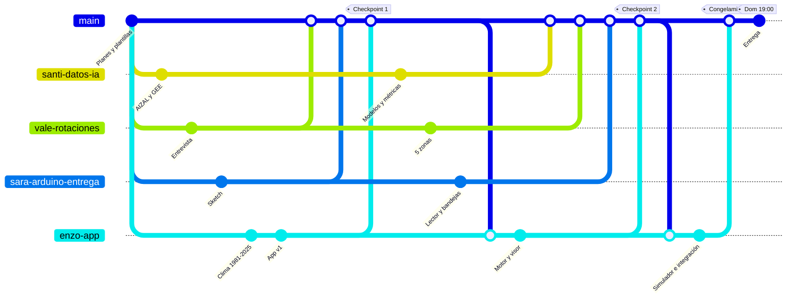
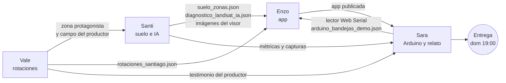

# Planes individuales: cómo trabajamos los 4 en paralelo

> **Estos planes son un punto de partida, no órdenes.** Enzo los armó para que los cuatro trabajemos al mismo tiempo, en ramas distintas y hacia el mismo objetivo. **Cada uno decide cómo abordar su parte:** el orden, las herramientas, el método y si cambia, saca o suma tareas.
>
> Lo único que conviene respetar entre todos son tres cosas:
> - el **objetivo común**;
> - el **formato de los archivos que compartimos** ([contratos](../docs/contratos-de-datos.md));
> - los **horarios de integración**.

---

## Objetivo común

**El domingo 15/11 a las 19:00 entregamos BioSat:** una app web publicada que ayuda a un productor de cualquiera de las **5 zonas de Santiago del Estero** a elegir una rotación de cultivos, con datos de la NASA, suelo local, un modelo de IA medido y un kit Arduino que mide en tierra.

**La pregunta que guía todo lo que hacemos:** *¿esto ayuda a que un productor santiagueño elija mejor su rotación, y lo podemos defender con datos?*

**Lo que tiene que existir el domingo:**

1. **La app publicada**, con los 5 pasos y las 5 zonas: tu campo, tu año, comparar, ¿y si…? y antes de decidir.
2. **Los 4 verbos del video de la NASA**, visibles en la app: comparar rotaciones, revelar compensaciones, comprender el riesgo y hacer visible la incertidumbre.
3. **Un modelo de IA medido**: tabla de métricas contra un método simple.
4. **El kit Arduino en vivo**, con lecturas grabadas de respaldo.
5. **El video o las diapositivas y la página del proyecto** en Space Apps.

---

## Quién hace qué

| # | Persona | Plan | Rama | Frentes | Archivos y carpetas propias |
|---|---|---|---|---|---|
| 1 | **Enzo** | [1-enzo.md](1-enzo.md) | `enzo-app` | F1 Clima · F5 App y motor · integración | `web/`, `scripts/descargar_nasa_power.py`, `data/clima_zonas.json`, `data/nasa_power_santiago_zonas.json`, `data/resumen_mensual_santiago.csv`, `data/raw_nasa_power/` |
| 2 | **Santi** | [2-santi.md](2-santi.md) | `santi-datos-ia` | F2 Suelo AIZAL · F3 IA Landsat | `ia_landsat/`, `scripts/*.js`, `data/datos_cruzados_aizal/`, `data/suelo_zonas.json`, `data/diagnostico_landsat_ia.json`, `data/imagenes/`, `ESTRUCTURA_DATOS.md`, `docs/cruce-de-datos.md` |
| 3 | **Vale** | [3-vale.md](3-vale.md) | `vale-rotaciones` | F4 Rotaciones y agronomía | `data/rotaciones_santiago.json`, `docs/zonas-santiago-y-kit-arduino.md`, `docs/documentacion-tecnica-agronomica.md`, `docs/glosario.md` |
| 4 | **Sara** | [4-sara.md](4-sara.md) | `sara-arduino-entrega` | F6 Arduino · F7 Entrega (coordina) | `arduino/`, `entrega/`, `data/arduino_bandejas_demo.json` |

**Archivos compartidos:** `PLAN.md`, `README.md`, `docs/reglas-y-bitacora.md`, `docs/contratos-de-datos.md` y esta carpeta `planes/README.md`. Los toca **solo Enzo, en `main`**. Cada plan personal (`planes/N-nombre.md`) lo edita solo su dueño.

---

## Cómo trabajamos con ramas

Las 4 ramas ya existen en GitHub, creadas desde `main`.

```bash
git fetch origin
git switch enzo-app            # tu rama (cada uno la suya)

# ...trabajás, y cada tanto:
git add <tus archivos>
git commit -m "F5: calendario del lote"   # sin la línea Co-Authored-By
git push                        # siempre a TU rama, nunca directo a main

# para traer lo que los demás ya integraron:
git fetch origin
git merge origin/main
```

**Para integrar tu trabajo en `main`** (en cada hito):

1. En tu rama: `git fetch origin && git merge origin/main` y probá que todo siga andando.
2. Abrí un *Pull Request* hacia `main`: botón en GitHub o `gh pr create --base main --fill`.
3. Si no hay conflictos, lo integra su dueño. Si hay dudas, avisá a Enzo.

**Orden de integración en cada hito:** primero los datos (Santi, Vale, Sara) y al final la app (Enzo). Así la app se prueba con los datos ya integrados.

---

## Reglas para no pisarnos

1. **Solo tocás tus archivos** (tabla de arriba). Si necesitás algo de otro, se lo pedís.
2. **Los formatos de los archivos compartidos no se cambian por tu cuenta.** Si hace falta, se avisa al grupo y Enzo actualiza [`contratos-de-datos.md`](../docs/contratos-de-datos.md).
3. **Tus avances:** tildá las casillas de tu plan. El README muestra el avance de cada uno cuando se integra a `main`.
4. **Tus decisiones:** anotalas en la sección "Mis decisiones" de tu plan. Enzo las pasa a la [bitácora](../docs/reglas-y-bitacora.md) en cada hito, así nadie edita la bitácora en paralelo.
5. **Nunca inventar números:** si un dato falta, va `null` y la app muestra "sin dato".
6. **Commits:** sin la línea `Co-Authored-By` (convención del equipo).
7. **Agentes de IA:** antes de tocar nada, leen este archivo, el plan de su dueño y los [contratos](../docs/contratos-de-datos.md), y trabajan solo en los archivos de esa persona.

**Plantillas listas:** los archivos compartidos ya están en `main` con la estructura del contrato y todo en `null`:
- `data/suelo_zonas.json`
- `data/diagnostico_landsat_ia.json`
- `data/rotaciones_santiago.json`
- `data/arduino_bandejas_demo.json`

Así Enzo puede programar la app desde el primer minuto, y cada dueño reemplaza su archivo cuando tenga datos reales.

---

## Hitos de integración

| Cuándo | Hito | Qué se integra a `main` |
|---|---|---|
| Sáb 16:30 | **Hito 0** | Cada uno en su rama y con su plan revisado. Sara confirma la hora y el formato de la entrega |
| Sáb 20:30 | **Checkpoint 1** | Clima real, rotaciones de la zona protagonista, sketch del Arduino y **app v1 publicada** |
| Dom 09:30 | **Checkpoint 2** | Suelo e IA (con la decisión de qué método se usa), rotaciones de las 5 zonas, lector del Arduino y app con compensaciones, riesgo y visor |
| Dom 15:00 | **Congelamiento** | Último merge de funciones. Después, solo arreglos en `main` |
| Dom 19:00 | **Entrega** | Proyecto subido a Space Apps |



---

## Qué necesita cada uno de los demás



Si alguien se atrasa, los demás no se frenan: la app muestra "sin dato" y se sigue. Los planes B de cada uno están en su plan y en el [PLAN general](../PLAN.md) §8.
